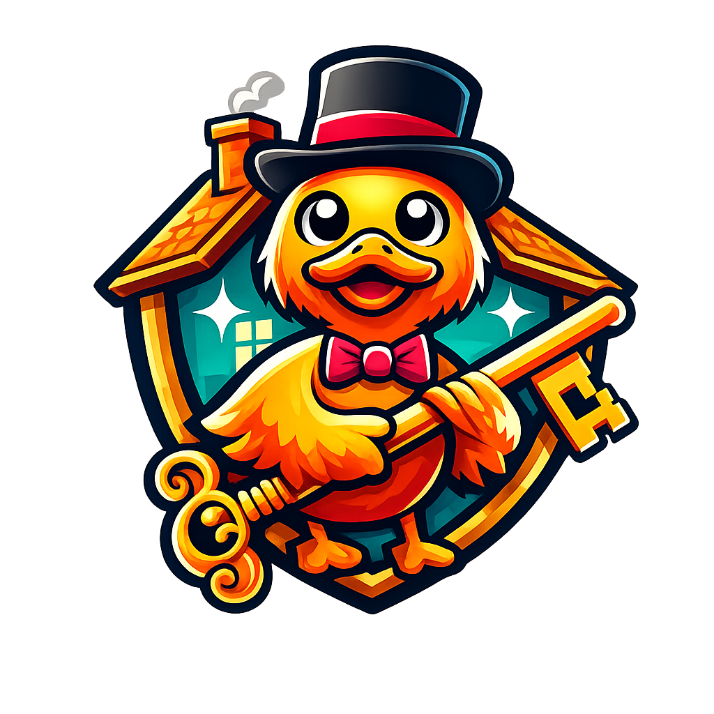

# ❄️🦯🦆 **QuackHack-McBLindy NixOS dotfiles** <br>

<!-- VERSIONS_START -->


<!-- VERSIONS_END -->


<div align="right"><sub>

_This is a <abbr title="Magically automated with duck-powered quackery">automagiduckically</abbr> updated README.md_

</sub></div>




[ "")](https://github.com/sponsors/QuackHack-McBlindy) [](https://buymeacoffee.com/quackhackmcblindy)


> [!CAUTION]
> __Do not blindly run this flake.__ <br>
> **That's my job.** 🧑‍🦯<br>
> [QuackHack-McBLindy.com](https://QuackHack-McBLindy.com)<br>


__Here lives all home machines/phone config files,__<br>
__and home automations, fully reproducible,__<br>
__crafted as a tiny Nix flake__<br>
__Glued together by a Nix-flavoured command line utility,__<br>
__easiy expanded and used to deploy, doc, and duck around__<br>


## **What Makes This Configuration Unique?**

**I manage my own homes!** <br>

❌ Home Manager - __No ducking way!__ I just auto symlink `./home` to `/home` <br>
❌ Home Assistant - __Quack no!__ No assistance needed! <br>

**This flake holds:** 

<!-- BADGES_START -->


<!-- BADGES_END -->


_List would get long, very quackly._ <br>
_perhaps a more suitable question would be:_ <br>
_"What makes this configuration common?_" <br>

<br>

**honorable mentions in my flake inputs:**
- 🔒[sops-nix](https://github.com/Mic92/sops-nix) - awesome secret keepin'.
- 🗣️[yo](https://github.com/QuackHack-McBlindy/yo) - holds my scripts and my grammar and runs voice pipeline.
- 🦆[zigduck](https://github.com/QuackHack-McBlindy/zigduck) - automates my house.


<br>

## ❄️ **Flake**

<details><summary><strong>
Define yourself at `config.this.user.me`.
</strong></summary>

<!-- USER_START -->
```nix
{
  discord = "https://discordapp.com/users/675530282849533952";
  dotfilesDir = "/home/pungkula/dotfiles";
  email = "isthisrandomenough@protonmail.com";
  extraGroups = [ "networkmanager" "wheel" "dialout" "docker" "dockeruser" "zigduck" "users" "pungkula" "adbusers" "audio" "2000" "i2c" "input" "mqtt" ];
  hashedPassword = "$y$j9T$m8hPD36i1VMaO5rurbZ4j0$KpzQyat.F6NoWFKpisEj77TvpN2wBGB8ezd26QoKDj6";
  matrix = "https://matrix.to/#/@quackhack-mcblindy:matrix.org";
  mobileDevices =   {
    iphone =     {
      pubkey = "UFB0T1Y/uLZi3UBtEaVhCi+QYldYGcOZiF9KKurC5Hw=";
      wgip = "10.0.0.7"
    };
    tablet =     {
      pubkey = "ETRh93SQaY+Tz/F2rLAZcW7RFd83eofNcBtfyHCBWE4=";
      wgip = "10.0.0.8"
    };
    watch =     {
      pubkey = "b28LFIbZSxbCLTaK7qsLp0hAMH+yo93+rVV14qif4hY=";
      wgip = "10.0.0.9"
    }
  };
  name = "pungkula";
  repo = "git@github.com:QuackHack-McBlindy/dotfiles.git"
}
```

<!-- USER_END -->

</details>


<details><summary><strong>
Define each hosts data at `config.this.host`.
</strong></summary>

<!-- HOST_START -->
```nix
{
  hostname = "desktop";
  interface = [ "enp119s0" ];
  ip = "192.168.1.111";
  keys =   {
    privateKeys =     {

    };
    publicKeys =     {
      adb = "QAAAACEJNfsfRV4PQ9Ah87MbTVbMkbXC6CAMDOR+0K6mIpv/4TSzYMkc2qit3Kryc55IVOjwR3fJRjj/uL549gZ7nEemWtcd3AsYQBp0iIEor8nu1L/V6jfsTY6Xe/pl06xoroy6OwZRWuDbZ4wD2xQRRQjfPd+JtYnMAWneM6r1V15uR67w4ITvjk3ckyfgNeLZMUwahMRjC3wSjaU9sAdKNmg8yPd8uHZ+mK6mstxJFAGEpnnm1lE7Z2r0DF6h6MKY1++dwhU+WM5BRDNiBg+D4i6fDW4+Z1I9ENuFnjT17zAxZXch04SNlG3O94BANYP7jmKp60OvtDL6msfphntuIUzMCkndF9De0Kv4lJdQxe1d+wf+AFpmtd/xtrk45YdMV+eWCJf2OkidaHmSj4ffkAobpun0VrkZN2Z1JymmdsvUbyMjAsby3Zun0xr3EocUS8Jy5TcsK/dcpD6CB5dqzlHhsHSAWt2TDwPzZYXgV1xc+q+PqM09OVN1xActJu75UMkg5b84U15hwQvYdwB8UaopMWWk6p064c7gxYSfH7fSxwkW2Jy1CElgJa55Pp4SZG9b/3B+VcNL1WSf6v/lvJqPbrRvBqvS0+e9wcFMNZtQKTX3n5X0wW1/czZPCQX+hmM8Uu1qrtaz4rKViIEGf4YR0/9eUGYQVfuAxAh8ZmsroJlnAAEAAQA= pungkula@desktop";
      age = "age16utg7mmk73cn3glrwthtm0p7mf6g3vrd48h3ucpn6wnf28pgxvcsh4rjjp";
      borg = "ssh-ed25519 AAAAC3NzaC1lZDI1NTE5AAAAIMVYczAOBSeS7WfSvzYDOS4Q9Ss+yxCf2G5MVfAALOx/";
      builder = "ssh-ed25519 AAAAC3NzaC1lZDI1NTE5AAAAINQ7c/AeIpmJS6cWQkHOe4ZEq3DXVRnjtTWuWfx6L46n";
      cache = "cache:/pbj1Agw2OoSSDZcClS69RHa1aNcwwTOX3GIEGKYwPc=";
      host = "ssh-ed25519 AAAAC3NzaC1lZDI1NTE5AAAAILdwPkRQxlbrbRGwEO5zMJ4m+7QqUQPZg1iqbd5HRP34";
      iPhone = "ssh-ed25519 AAAAC3NzaC1lZDI1NTE5AAAAIOMcmr+z7k/yCbrFg+JDgo8JCuWqNVYn10ajRbNTp8fq";
      ssh = "ssh-ed25519 AAAAC3NzaC1lZDI1NTE5AAAAIPwZL27kGTQDIlSe03abT9F24nSAizORyjo5cI3BD92s";
      wireguard = "Oq0ZaYAnOo5sLpV//OEFwLgjVCxPyeQqf8cZBASluWk="
    }
  };
  modules =   {
    hardware = [ "cpu/intel" "audio" ];
    networking = [ "default" "pool" ];
    programs = [ "default" "thunar" "firefox" "vesktop" ];
    services = [ "ssh" "default" "yo" "yo-client" "adb" "openrgb" "backup" "cache" "keyd" "jelly" "duckdns" "sunshine" ];
    system = [ "nix" "pkgs" "gnome" "crossEnv" "gtk" ];
    virtualisation = [ "docker" "vm" ]
  };
  system = "x86_64-linux";
  wgip = "10.0.0.2"
}
```

<!-- HOST_END -->

</details>


<details><summary><strong>
Define any optional theme configuration at `config.this.theme`.
</strong></summary>

<!-- THEME_START -->
```nix
{
  cursorTheme =   {
    name = "Bibata-Modern-Classic";
    package = "/nix/store/y0sdbvmrkqaia8vwsq0dxps6fxp72wkn-bibata-cursors-2.0.7";
    size = 32
  };
  enable = false;
  fonts =   {
    monospace = "Fira Code";
    packages = [ "/nix/store/2ld298l8y0c3dfvk9gnnhzxm6szmcbhz-fira-code-6.2" ];
    system = "Fira Sans"
  };
  gtkSettings =   {
    gtk-application-prefer-dark-theme = "1";
    gtk-cursor-theme-name = "Bibata-Modern-Classic";
    gtk-icon-theme-name = "elementary-xfce-icon-theme"
  };
  iconTheme =   {
    name = "Papirus-Dark";
    package = "/nix/store/k6afm6silmlq8dbzxc55gwqnijs9rwc4-papirus-icon-theme-20260801"
  };
  name = "gtk3.css";
  styles = "/nix/store/wg23gpsvsws9j5r5r1v9369pa4vfyv15-gtk3.css"
}
```

<!-- THEME_END -->

</details>


<details><summary><strong>
Define Zigbee-devices, scenes, automations, tv's, channels etc at `config.house`.
</strong></summary>

<!-- SMARTHOME_START -->
# dotfiles/modules/myHouse.nix ⮞ https://github.com/quackhack-mcblindy/dotfiles
```nix
# dotfiles/modules/myHouse.nix ⮞ https://github.com/quackhack-mcblindy/dotfiles
#  » ★ QuackHack-McBLindy.com ★ «
# 🦆 ⮞ my house - qwack! u wanna copy pasta?
{ #  » ★ github.com/QuackHack-McBlindy/zigduck ★ «
  config,
  lib,
  self,
  zigduck,
  hosts,
  devices,
  icons,
  pkgs,
  ...
} : let # 🦆 say ⮞ load dash pages css files
  strip = text:
    builtins.replaceStrings [ "/*" "*/" ] [ "" "" ] text;

  # 🦆 says ⮞ load custom pages 4 dashboard
  customPages = import ./dashboard.nix { inherit lib config pkgs; };
  pages       = customPages.pages;

  # 🦆 says ⮞ load css files
  css = {
    tv        = builtins.readFile ./themes/css/duckdash/tv.css;
    chat      = builtins.readFile ./themes/css/duckdash/chat.css;
  };

  # 🦆 says ⮞
  Mqtt2jsonHistory = field: file: ''
    FILE="${zigduck.stateDir}/${file}"
    VALUE=$(echo "$MQTT_PAYLOAD" | jq '.${field}')
    mkdir -p "$(dirname "$FILE")"

    # 🦆 says ⮞ check current value
    if [ -s "$FILE" ]; then
        CURRENT=$(jq ".${field}" "$FILE")
        if [ "$CURRENT" = "$VALUE" ]; then
            exit 0 # 🦆 says ⮞ skip write – value unchanged
        fi
    fi

    # 🦆 says ⮞ otherwise, update
    if [ ! -s "$FILE" ]; then
        jq -n --argjson v "$VALUE" \
            '{ ${field}: $v, history: [$v] }' > "$FILE"
    else
        jq --argjson v "$VALUE" '
            .${field} = $v
            | .history += [$v]
            | .history = (.history[-200:])
        ' "$FILE" > "$FILE.tmp" && mv "$FILE.tmp" "$FILE"
    fi
  '';

  # 🦆 says ⮞ detect summer/winter time (for EPG)
  flakeEpoch =
    if self ? lastModified then toString self.lastModified
    else throw "flake has no lastModified — needs to be a git-backed flake";
  tzProbe = pkgs.runCommand "tz-probe" {
    nativeBuildInputs = [ pkgs.tzdata ];
    env.TZDIR = "${pkgs.tzdata}/share/zoneinfo";
    env.EPOCH = flakeEpoch;
  } ''
    TZ=Europe/Stockholm date -d "@$EPOCH" +%z > $out
  '';
  tzOffset = lib.strings.trim (builtins.readFile tzProbe);
  timezone_offset_hours = {
    "+0100" = -1;
    "+0200" = -2;
  }.${tzOffset} or (throw "unexpected TZ offset from tzdata: ${tzOffset}");
in { # 🦆 duck say ⮞ house config
  house = {
    # 🦆 says ⮞ ROOM CONFIGURATION
    rooms = {
      bedroom.icon    = icons.room.bedroom;
      hallway.icon    = icons.room.hallway;
      kitchen.icon    = icons.room.kitchen;
      livingroom.icon = icons.room.livingroom;
      wc.icon         = icons.room.wc;
      tv-area = {
        entertainment = true;
        icon          = icons.tv;
      };
      other.icon      = icons.room.other;
    };

    # 🦆 says ⮞ media
    https.media.urlFile       = config.sops.secrets.webserver.path;
    media.root                = "/Pool";
    media.youtubePasswordFile = config.sops.secrets.youtube_api_key.path;
    media = {
      movies      = "${config.house.media.root}/Movies";
      tv          = "${config.house.media.root}/TV";
      music       = "${config.house.media.root}/Music";
      musicVideos = "${config.house.media.root}/Music_Videos";
      otherVideos = "${config.house.media.root}/Other_Videos";
      podcasts    = "${config.house.media.root}/Podcasts";
      audiobooks  = "${config.house.media.root}/Audiobooks";
    };

# 🦆 ⮞ DEVICES ⮜
    devices = {
      # 🦆 ⮞ NixOS machines....
      "desktop" = { # 🦆 ⮞ mqtt published @ "zigduck/desktop"
        enable  = true; # 🦆 ⮞ will be displayed in da frontend!
        room    = "other"; # 🦆 ⮞ i pub system health there yo (json)
        icon    = icons.desktop;
        ip      = hosts.desktop.ip;
      };
      "homie"   = {
        enable  = true;
        room    = "other";
        icon    = icons.desktop;
        ip      = hosts.homie.ip;
      };
      "nasty"   = {
        enable  = true;
        room    = "other";
        icon    = icons.desktop;
        ip      = hosts.nasty.ip;
      };

      # 🦆 ⮞ ★ ESP32-S3-WATCH-rs ★ » https://github.com/QuackHack-McBlindy/ESP32-S3-WATCH-rs
      "watch"   = {
        enable  = true;
        room    = "other";
        icon    = icons.watch;
        ip      = "192.168.1.182";
        state.endpoint = "/api/sensors"; # ⮜ 🦆 says ⮞ refresh device states from this endpoint
        state.refresh  = null; # ⮜ 🦆 every x sec (null = only on demand)      

        # 🦆 ⮞ create action controls for automations / frontend control
        controls = { # 🦆 ⮞ publish your devices payload @ "zigduck/watch" to show in frontend
          brightness    = { # 🦆 ⮞ if u interact with da "brightness" slider it will publish @ "zigduck/watch/set"
            type        = "slider"; # 🦆 ⮞ which then will run the corresponding defined action
            icon        = icons.brightness;
            min         = 0;
            max         = 100;
            description = "Controls the display backlight brightness level";
            actions     = [{ type = "shell"; command = "curl http://$IP/api/settings/display/brightness/$VALUE"; }];
          };
          battery_percent = {
            description   = "Displays the battery percentage on the watch.";
            type          = "sensor";
            icon          = icons.battery;
          };
          rssi          = {
            description = "Displays the current RSSI on the watch.";
            type        = "sensor";
            icon        = icons.wifi;
          };
          display_state = {
            description = "Toggles the state of the display.";
            type        = "bool";
            icon        = icons.display;
            actions = [{ type = "shell"; command = "curl http://$IP/api/settings/display/state/toggle"; }];
          };
          display_timeout = {
            description   = "Configure the idle time in seconds before the display turns off.";
            type          = "slider";
            icon          = icons.display;
            min           = 0;
            max           = 300;
            actions = [{ type = "shell"; command = "curl http://$IP/api/settings/display/timeout/$VALUE"; }];
          };
          mic_volume    = {
            description = "Configure the microphone gain.";
            type        = "slider";
            icon        = icons.microphone;
            min         = 0;
            max         = 100;
            actions = [{ type = "shell"; command = "curl http://$IP/api/settings/mic/volume/$VALUE"; }];
          };
          mic_muted     = {
            description = "Mute the microphone";
            type        = "bool";
            icon        = icons.mic_off;
            actions = [{ type = "shell"; command = "curl http://$IP/api/settings/mic/mute/toggle"; }];
          };
          speaker_volume = {
            description  = "Change the watch speaker volume.";
            type         = "slider";
            icon         = icons.volume;
            min          = 0;
            max          = 100;
            actions = [{ type = "shell"; command = "curl http://$IP/api/settings/speaker/volume/$VALUE"; }];
          };
          speaker_muted = {
            description = "Mute the speaker on the watch";
            type        = "bool";
            icon        = icons.mute;
            actions = [{ type = "shell"; command = "curl http://$IP/api/settings/speaker/mute/toggle"; }];
          };
          amplifier_state = {
            description   = "Turn the amplifier state on/off.";
            type          = "bool";
            icon          = icons.amplifier;
            actions = [{ type = "shell"; command = "curl http://$IP/api/settings/speaker/amp/toggle"; }];
          };
          speaker_task_state  = {
            description       = "Turn the speaker task on the watch on/off.";
            type              = "bool";
            icon              = icons.speaker;
            actions = [{ type = "shell"; command = "curl http://$IP/api/settings/speaker/toggle"; }];
          };
          speaker_allow_streaming = {
            description = "Enabling this allows the watch to playback audio sent over LAN.";
            type        = "bool";
            icon        = icons.cast;
            actions = [{ type = "shell"; command = "curl http://$IP/api/settings/speaker/stream/toggle"; }];
          };
          play_ding = {
            description = "Play ding sound on the watch.";
            type        = "bool";
            icon        = icons.speaker;
            actions = [{
              type      = "shell";
              command   = ''if [ "$VALUE" = "true" ]; then curl -s "http://$IP/api/settings/speaker/play/ding"; fi'';
            }];
          };
          media_play_pause = {
            description    = "Toggles the media player state on the watch between play/pause.";
            type           = "bool";
            icon           = icons.play_pause;
            actions = [{
              type         = "shell";
              command      = ''if [ "$VALUE" = "true" ]; then curl -s "http://$IP/api/media/play_pause"; fi'';
            }];
          };
          cpu_freq = {
            description = "Change clock frequency on the watch.";
            type        = "slider";
            icon        = icons.cpu;
            values      = [ "80" "160" "240" ];
            actions = [{ type = "shell"; command = "curl http://$IP/api/settings/cpu/$VALUE"; }];
          };
          low_power_mode = {
            description  = "Toggles low power mode on/off, turning off basically every task that draws battery.";
            type         = "bool";
            icon         = icons.power_sleep;
            actions = [{ type = "shell"; command = "curl http://$IP/api/settings/power/low/toggle"; }];
          };
          ssh_state     = {
            description = "Toggle SSHd on/off.";
            type        = "bool";
            icon        = icons.console;
            actions = [{ type = "shell"; command = "curl http://$IP/api/settings/ssh/toggle"; }];
          };
          vpn_state     = {
            description = "Toggle VPN on/off.";
            type        = "bool";
            icon        = icons.vpn;
            actions = [{ type = "shell"; command = "curl http://$IP/api/settings/vpn/toggle"; }];
          };
        };
      };

      # 🦆 ⮞ ★ ESP32-S3-BOX-3-rs ★ » https://github.com/QuackHack-McBlindy/ESP32-S3-BOX-3-rs
      "ESP32-S3-BOX-3" = {
        enable = true;
        room   = "other";
        icon   = icons.microphone;
        ip     = "192.168.1.16";        
        state.endpoint = "/api/sensors";
        state.refresh  = 60;
        
        controls = {
          battery_percent = {
            description   = "Displays the battery percentage.";
            type          = "sensor";
            icon          = icons.battery;
          };
          presence      = {
            description = "Presence detection.";
            type        = "sensor";
            icon        = icons.sensor.motion;
          };
          temperature   = {
            description = "Temperature sensor.";
            type        = "sensor";
            icon        = icons.sensor.temperature;
          };
          humidity      = {
            description = "Humidity sensor.";
            type        = "sensor";
            icon        = icons.sensor.humidity;
          };
          uptime        = {
            description = "Time since last boot.";
            type        = "sensor";
            icon        = icons.uptime;
          };
          firmware      = {
            description = "Displays the currently running firmware version om the device.";
            type        = "sensor";
            icon        = icons.battery;
          };
          rssi          = {
            description = "Displays the current RSSI.";
            type        = "sensor";
            icon        = icons.wifi;
          };
          brightness    = {
            description = "Controls the display backlight brightness level";
            type        = "slider";
            icon        = icons.brightness;
            min         = 0;
            max         = 100;
            actions = [{ type = "shell"; command = "curl http://$IP/api/settings/display/brightness/$VALUE"; }];
          };
          display_state = {
            description = "Toggles the state of the display.";
            type        = "bool";
            icon        = icons.display;
            actions = [{ type = "shell"; command = "curl http://$IP/api/settings/display/state/toggle"; }];
          };
          display_timeout = {
            description   = "Idle seconds before display turns off.";
            type          = "slider";
            icon          = icons.display;
            min           = 0;
            max           = 300;
            actions = [{ type = "shell"; command = "curl http://$IP/api/settings/display/timeout/$VALUE"; }];
          };
          display_page  = {
            description = "Change display page.";
            type        = "slider";
            icon        = icons.display_page;
            values      = [ "0" "1" "2" "10" ];
            actions = [{ type = "shell"; command = "curl http://$IP/api/settings/display/page/$VALUE"; }];
          };
          mic_volume    = {
            description = "Configure the microphone gain.";
            type        = "slider";
            icon        = icons.microphone;
            min         = 0;
            max         = 100;
            actions = [{ type = "shell"; command = "curl http://$IP/api/settings/mic/volume/$VALUE"; }];
          };
          mic_muted     = {
            description = "Mute the microphone.";
            type        = "bool";
            icon        = icons.mic_off;
            actions = [{ type = "shell"; command = "curl http://$IP/api/settings/mic/mute/toggle"; }];
          };
          speaker_volume = {
            description  = "Change the speaker volume.";
            type         = "slider";
            icon         = icons.volume;
            min          = 0;
            max          = 100;
            actions = [{ type = "shell"; command = "curl http://$IP/api/settings/speaker/volume/$VALUE"; }];
          };
          speaker_muted = {
            description = "Mute the speaker.";
            type        = "bool";
            icon        = icons.mute;
            actions = [{ type = "shell"; command = "curl http://$IP/api/settings/speaker/mute/toggle"; }];
          };
          amplifier_state = {
            description   = "Turn the amplifier on/off.";
            type          = "bool";
            icon          = icons.amplifier;
            actions = [{ type = "shell"; command = "curl http://$IP/api/settings/speaker/amp/toggle"; }];
          };
          speaker_task_state = {
            description      = "Turn the speaker task on/off.";
            type             = "bool";
            icon             = icons.speaker;
            actions = [{ type = "shell"; command = "curl http://$IP/api/settings/speaker/toggle"; }];
          };
          speaker_allow_streaming = {
            description = "Allow playback of audio sent over LAN.";
            type        = "bool";
            icon        = icons.cast;
            actions = [{ type = "shell"; command = "curl http://$IP/api/settings/speaker/stream/toggle"; }];
          };
          play_ding     = {
            description = "Play test ding sound.";
            type        = "bool";
            icon        = icons.speaker;
            actions = [{
              type      = "shell";
              command   = ''if [ "$VALUE" = "true" ]; then curl -s "http://$IP/api/settings/speaker/play/ding"; fi'';
            }];
          };
          ding          = {
            description = "Play awake sound and light up display.";
            type        = "bool";
            icon        = icons.bell;
            actions = [{ type = "shell"; command = ''if [ "$VALUE" = "true" ]; then curl -s "http://$IP/api/ding"; fi''; }];
          };
          done          = {
            description = "Play done sound and dim display.";
            type        = "bool";
            icon        = icons.check;
            actions = [{ type = "shell"; command = ''if [ "$VALUE" = "true" ]; then curl -s "http://$IP/api/done"; fi''; }];
          };

          media_play_pause = {
            description    = "Toggle media play/pause.";
            type           = "bool";
            icon           = icons.play_pause;
            actions = [{
              type         = "shell";
              command      = ''if [ "$VALUE" = "true" ]; then curl -s "http://$IP/api/media/play_pause"; fi'';
            }];
          };
          media_prev    = {
            description = "Previous track.";
            type        = "bool";
            icon        = icons.skip_prev;
            actions = [{
              type      = "shell";
              command   = ''if [ "$VALUE" = "true" ]; then curl -s "http://$IP/api/media/prev"; fi'';
            }];
          };
          media_next    = {
            description = "Next track.";
            type        = "bool";
            icon        = icons.skip_next;
            actions = [{
              type      = "shell";
              command   = ''if [ "$VALUE" = "true" ]; then curl -s "http://$IP/api/media/next"; fi'';
            }];
          };
          media_heart   = {
            description = "Save current track to favourites.";
            type        = "bool";
            icon        = icons.heart;
            actions = [{
              type      = "shell";
              command   = ''if [ "$VALUE" = "true" ]; then curl -s "http://$IP/api/media/heart"; fi'';
            }];
          };
          media_playlist_clear = {
            description = "Clear the temporary playlist.";
            type        = "bool";
            icon        = icons.playlist_remove;
            actions = [{
              type      = "shell";
              command   = ''if [ "$VALUE" = "true" ]; then curl -s "http://$IP/api/media/playlist/clear"; fi'';
            }];
          };
          voice_state   = {
            description = "Toggle the entire voice pipeline.";
            type        = "bool";
            icon        = icons.voice;
            actions = [{ type = "shell"; command = "curl http://$IP/api/settings/voice/toggle"; }];
          };
          wake_word_enabled = {
            description  = "Toggle wake-word streaming.";
            type         = "bool";
            icon         = icons.wakeword;
            actions = [{ type = "shell"; command = "curl http://$IP/api/settings/voice/wakeword/toggle"; }];
          };
          intercom_state = {
            description  = "Toggle intercom mode.";
            type         = "bool";
            icon         = icons.intercom;
            actions = [{ type = "shell"; command = "curl http://$IP/api/settings/voice/intercom/toggle"; }];
          };
          cpu_freq      = {
            description = "Change clock frequency.";
            type        = "slider";
            icon        = icons.cpu;
            values      = [ "80" "160" "240" ];
            actions = [{ type = "shell"; command = "curl http://$IP/api/settings/cpu/$VALUE"; }];
          };
          low_power_mode = {
            description  = "Toggle low power mode.";
            type         = "bool";
            icon         = icons.power_sleep;
            actions = [{ type = "shell"; command = "curl http://$IP/api/settings/power/low/toggle"; }];
          };
          reboot        = {
            description = "Reboot the device.";
            type        = "bool";
            icon        = icons.power_sleep;
            actions = [{ type = "shell"; command = "curl http://$IP/api/settings/power/reboot"; }];
          };
          ssh_state     = {
            description = "Toggle SSHd.";
            type        = "bool";
            icon        = icons.console;
            actions = [{ type = "shell"; command = "curl http://$IP/api/settings/ssh/toggle"; }];
          };
          vpn_state     = {
            description = "Toggle VPN.";
            type        = "bool";
            icon        = icons.vpn;
            actions = [{ type = "shell"; command = "curl http://$IP/api/settings/vpn/toggle"; }];
          };
        };
      };
    };

# 🦆 ⮞ ZIGBEE ⮜ 🐝
    zigbee = {
      # 🦆 says ⮞ encrypted zigbee network key
      networkKeyFile = config.sops.secrets.z2m_network_key.path;

      # 🦆 says ⮞ mosquitto authentication
      mosquitto = {
        host  = (lib.findFirst
              (h: lib.elem "zigduck" h.modules.services)
              (throw "NO ZIGDUCK HOST")
              (lib.attrValues hosts)).ip;
        username     = "mqtt";
        passwordFile = config.sops.secrets.mosquitto.path;
        baseTopic    = "zigduck";
      };

      # 🦆 says ⮞ TV light syncin'
      hueSyncBox = {
        enable   = true;
        # 🦆 says ⮞ sadly needed (i disable itz internet access - u should too)
        bridge   = {
          # 🦆 says ⮞ run the following to get api token:
          # curl -X POST http://192.168.1.33/api -d '{"devicetype":"house#nixos"}'
          ip           = "192.168.1.33";
          passwordFile = config.sops.secrets.hueBridgeAPI.path;
        };
        syncBox = { # C42996020AAE
          # 🦆 says ⮞ run the following to get api token for the sync box:
          # curl -k -sS -X POST "https://192.168.1.34/api/v1/registrations" -H "Content-Type: application/json" -d '{"appName": "zigduck", "instanceName": "zigduck"}'
          ip           = "192.168.1.34";
          passwordFile = config.sops.secrets.hueSyncAPI.path;
          tv           = "shield";
        };
      };

      # 🦆says⮞ coordinator configuration
      coordinator = {
        vendorId  =  "10c4";
        productId = "ea60";
        symlink   = "zigbee"; # 🦆 says ⮞ diz symlinkz da serial port to /dev/zigbee
      };

      # 🦆 says ⮞ optional dimmer config
      dimmer = {
        message            = "action";
        doubleClickTimeout = 500;
      };

      # 🦆 says ⮞ when motion triggers lights
      motion = {
        when.dark.enable = true;
        trigger.lights = {
          after        = 14;
          before       = 9;
          duration     = 700;
          transition   = true;
        };
      };

      # 🦆 says ⮞ when no motion triggers ALL lights off
      no.motion.trigger = {
        all.lights.off  = {
          enable  = true;
          after   = 90; # 🦆 says ⮞  min
          exclude = [ ]; # 🦆 says ⮞ list of strings, devices to exclude (friendly name, leaves their states as-is)
        };
      };


  # 🦆 ⮞ AUTOMATIONS ⮜
      automations = {
      # 🦆 says ⮞ there are 6 different automation types
        # 🦆 says ⮞ + a greeting automation
        greeting  = {
          enable       = true;
          awayDuration = 7200;
          door         = "Door Sensor Hall";
          delay        = 10;
          actions = [ { type = "shell"; command = "zigduck-cli --notify '🚪 Welcome back!'"; } ];
        };


        # 🦆 says ⮞ 1. MQTT triggered automations
        mqtt_triggered  = {

          flash_lights  = {
            enable      = true;
            description = "Flash lights";
            topic       = "${zigduck.baseTopic}/effects/flash";
            actions  = [
              { type = "snapshot"; snapshot_name = "before_timer"; }
              { type = "scene"; scene = "max"; }
              { type = "wait"; duration = 2; }
              { type = "scene"; scene = "dark-fast"; }
              { type = "wait"; duration = 2; }
              { type = "scene"; scene = "max"; }
              { type = "wait"; duration = 2; }
              { type = "scene"; scene = "dark-fast"; }
              { type = "wait"; duration = 2; }
              { type = "scene"; scene = "max"; }
              { type = "wait"; duration = 2; }
              { type = "restore"; snapshot_name = "before_timer"; }
            ];
          };

          alarm_wakeup  = {
            enable      = true;
            description = "Time to wake up!";
            topic       = "${zigduck.baseTopic}/alarm/triggered";
            actions  = [ # 🦆 say ⮞ START WITH A NOTIFY
              { type = "shell"; command = "zigduck-cli --notify '⏰ ALARM: Wake up!'"; }
              # 🦆 SCREAMS ⮞ FLASH LIGHTS!
              { type = "mqtt"; topic = "${zigduck.baseTopic}/effects/flash"; message = " "; }
              # 🦆 says ⮞ TTS time to wake up
              { type = "shell"; command = "yo say 'wakieee wakiee dags att vaknaaaaaaa'"; }
              # 🦆 says ⮞ fuck up bed (neck up + feet up)
              { type = "mqtt"; topic = "${zigduck.baseTopic}/Robot Arm 3/set"; message = ''{"state":"OFF"}''; }
              { type = "mqtt"; topic = "${zigduck.baseTopic}/Robot Arm 4/set"; message = ''{"state":"OFF"}''; }
              { type = "wait"; duration = 10; }
              # 🦆 says ⮞ FLASH!
              { type = "mqtt"; topic = "${zigduck.baseTopic}/effects/flash"; message = " "; }
              # 🦆 ⮞ play sound on bedroom esp32 assistant
              { type = "shell"; command = "curl http://${devices.ESP32-S3-BOX-3.ip}/api/settings/speaker/play/ding"; }
              { type = "wait"; duration = 2; }
              # 🦆 says ⮞ ping watch with a ding
              { type = "shell"; command = "curl http://${devices.watch.ip}/api/settings/speaker/play/ding"; }
              # 🦆 says ⮞ gib me a sec pls...
              { type = "wait"; duration = 10; }
              # 🦆 says ⮞ roll up da blindz let da sun come in
              { type = "mqtt"; topic = "${zigduck.baseTopic}/Roller Shade/set"; message = ''{"state":"ON"}''; }
              # 🦆 says ⮞ check if im up yet....
              { type = "shell"; command = ''
                motion=$(jq -r '."Motion Sensor Sovrum".occupancy' ${zigduck.stateDir}/state.json)
                # 🦆 says ⮞  if my lazy ass is still in bed, try calling the TV remote!
                if [[ "$motion" == "false" ]]; then
                  tv --typ call
                fi
              ''; }
            ];
          };

          timer_finish  = {
            enable      = true;
            description = "a timer is ringing";
            topic       = "${zigduck.baseTopic}/timer/finished";
            actions  = [ # 🦆 says ⮞ notify
              { type = "shell"; command = "zigduck-cli --notify '⏰ TIMER finish!'"; }
              # 🦆 says ⮞ FLASH!
              { type = "mqtt"; topic = "${zigduck.baseTopic}/effects/flash"; message = " "; }
              # 🦆 says ⮞ ping watch with ding
              { type = "shell"; command = "curl http://${devices.watch.ip}/api/settings/speaker/play/ding"; }
              { type = "wait"; duration = 7; }
            ];
          };

      # 🦆 says ⮞ below are used to create cards
      # 🦆 says ⮞ cards are read & displayed by the frontend
          # 🦆say⮞ crypto tickers
          xmr           = {
            enable      = true;
            description = "Updating XMR price data on dashboard";
            topic       = "${zigduck.baseTopic}/crypto/xmr/price";
            actions     = [{ type = "shell"; command = Mqtt2jsonHistory "current_price" "xmr.json"; }];
          };
          btc           = {
            enable      = true;
            description = "Updating BTC price data on dashboard";
            topic       = "${zigduck.baseTopic}/crypto/btc/price";
            actions     = [{ type = "shell"; command = Mqtt2jsonHistory "current_price" "btc.json"; }];
          };
          # 🦆say⮞ energy tracking
          energyPrice   = {
            enable      = true;
            description = "Updating energy data on dashboard";
            topic       = "${zigduck.baseTopic}/tibber/energy";
            actions     = [{ type = "shell"; command = Mqtt2jsonHistory "current_price" "energy_price.json"; }];
          };
          energyUsage   = {
            enable      = true;
            description = "Updating energy data on dashboard";
            topic       = "${zigduck.baseTopic}/tibber/energy";
            actions     = [{ type = "shell"; command = Mqtt2jsonHistory "monthly_usage" "energy_usage.json"; }];
          };
          # 🦆say⮞ hallway temperature
          temperature   = {
            enable      = true;
            description = "Updating temperature data on dashboard";
            topic       = "${zigduck.baseTopic}/Motion Sensor Hall";
            actions     = [{ type = "shell"; command = Mqtt2jsonHistory "temperature" "temperature.json"; }];
          };
          # 🦆say⮞ calendar
          calendar      = {
            enable      = true;
            description = "Updated calendar events";
            topic       = "${zigduck.baseTopic}/calendar";
            actions = [
              { type    = "shell";
                command = ''
                  iso_date=$(echo "$MQTT_PAYLOAD" | jq -r '.today_date')
                  formatted_date=$(date -d "$iso_date" +"%b %d")
                  MQTT_PAYLOAD=$(echo "$MQTT_PAYLOAD" | jq --arg d "$formatted_date" '.today_date = $d')
                  echo "$MQTT_PAYLOAD" > ${zigduck.stateDir}/calendar.json
                '';
              }
            ];
          };
        };

        # 🦆 says ⮞ 2. room action automations
        room_actions = {
          hallway = {
            door_opened = [ # 🦆 says ⮞ ping watch & send notification
              { type = "shell"; command = "zigduck-cli --notify '🚪 DOOR OPEN!'"; }
              { type = "shell"; command = "curl http://${devices.watch.ip}/api/settings/speaker/play/ding"; }
            ];
            door_closed = [];
          };

          kitchen = {
            motion_not_detected = [
              {
                type = "shell";
                command = ''
                  power=$(jq -r '."Fläkt".power' ${zigduck.stateDir}/state.json)
                  # 🦆 says ⮞ no need 2 turn off if it'z not on
                  if (( power > 20 )); then
                    zigduck-cli --publish --topic "${zigduck.baseTopic}/Fläkt/set" --payload '{"countdown": 180}'
                  fi
                '';
              } # 🦆 says ⮞  slow go light go bye bye
              { type = "scene"; scene = "kitchenFadeOff"; }
            ];

            motion_detected = [
              { type = "scene"; scene = "kitchenInstant"; }
              { type = "shell";
                command = ''
                  # 🦆 says ⮞ cancel any pending countdown
                  zigduck-cli --publish --topic "${zigduck.baseTopic}/Fläkt/set" --payload '{"countdown": 0}'

                  # 🦆 says ⮞ if fan is off - start it
                  STATE=$(jq -r '."Fläkt".state' ${zigduck.stateDir}/state.json)
                  if [ "$STATE" = "OFF" ]; then
                    zigduck-cli --device "Fläkt" --state on
                  fi

                  # 🦆 says ⮞ if my team is playing NOW - go green!!
                  if jq -e '
                       def epoch: (strptime("%Y%m%d%H%M%S +0000") | mktime);
                       now as $now
                       | any(.channels[].programs[];
                           ((.start | epoch) <= $now)
                           and ((.stop  | epoch) >  $now)
                           and (.title | ascii_downcase | contains("björklöven")))
                     ' "${zigduck.stateDir}/epg.json" > /dev/null 2>&1; then
                    zigduck-cli --scene "kitchenGreenInstant"
                  fi
                '';
              }
            ];
          };
        };

        # 🦆 says ⮞ 3. global actions automations
        global_actions  = {
          leak_detected = [ # 🦆 QUICK ⮞ FLASH FOR DA NOTICE
            { type = "mqtt"; topic = "${zigduck.baseTopic}/effects/flash"; message = " "; }
            # 🦆 LIGHT⮞FAST⮞HELP⮞SEE⮞THEN⮞NOTIFY
            { type = "scene"; scene = "max"; }
            { type = "shell"; command = "zigduck-cli --notify '💧 🚨 WATER LEAK DETECTED!'"; }
            # 🦆 says ⮞ ping watch with ding
            { type = "shell"; command = "curl http://${devices.watch.ip}/api/settings/speaker/play/ding"; }
            # 🦆SAY⮞CALM⮞DOWN⮞itz⮞juzt⮞water
            { type = "shell"; command = "yo say 'eld eld eld'"; }
          ];

          smoke_detected = [ # 🦆 QUICK ⮞ FLASH FOR DA NOTICE
            { type = "mqtt"; topic = "${zigduck.baseTopic}/effects/flash"; message = " "; }
            # 🦆 LIGHT⮞FAST⮞HELP⮞SEE
            { type = "scene"; scene = "max"; }
            { type = "shell"; command = "zigduck-cli --notify '🔥 FIRE/SMOKE DETECTED!' --tag critical"; }
            # 🦆 says ⮞ ping watch with ding
            { type = "shell"; command = "curl http://${devices.watch.ip}/api/settings/speaker/play/ding"; }
            # 🦆SAY⮞FIRE
            { type = "shell"; command = "yo say 'eld eld eld'"; }
          ];
        };

        # 🦆 says ⮞ 4. dimmer actions automations
        dimmer_actions = {
          bedroom      = {
            off_hold_release   = {
              enable           = true;
              description      = "Turn off all configured light devices";
              extra_actions    = [];
              override_actions = [
                { type = "scene"; scene = "dark"; }
                { type = "mqtt"; topic = "${zigduck.baseTopic}/Fläkt/set"; message = ''{"state":"OFF"}''; }
              ];
            };
          };

          kitchen = {
            on_press_release = {
              enable         = true;
              description    = "Turn on kitchen fan (+ lights)";
              extra_actions  = [
                {
                  type       = "mqtt";
                  topic      = "${zigduck.baseTopic}/Fläkt/set";
                  message    = ''{"state":"ON"}'';
                }
              ];
              override_actions = [ ];
            };
          };
        };

        # 🦆 says ⮞ 5. time based automations
        time_based = {
          morning_wakeup = {
            enable       = true;
            description  = "set morning wakeup alarm (dont miss lunch)";
            # 🦆 says ⮞ 01 AM mon-fri
            schedule     = {
              start      = "01:00";
              days       = ["mon" "tue" "wed" "thu" "fri"];
            };
            # 🦆 says ⮞ 11 AM (i like to sleep in)
            actions      = [ "zigduck-cli alarm add --hours 10 --minutes 45 --name vakna" ];
          };

          # 🦆 says ⮞ daily tv scraper
          tv_scraping   = {
            enable      = true;
            description = "Scrape TV-guide";
            # 🦆 says ⮞ 03:30 AM everyday
            schedule    = {
              start     = "03:30";
              days      = ["mon" "tue" "wed" "thu" "fri" "sat" "sun"];
            };
            # 🦆 says ⮞ scrape & save so dashboard can read
            actions  = [ "tv-scraper --json-out ${zigduck.stateDir}/epg.json --html-out ${zigduck.stateDir}/tv.html --xml-out ${zigduck.stateDir}/epg.xml" ];
          };
        };

        # 🦆 says ⮞ 6. presence based automations
        presence_based = {};
      };


# 🦆 ⮞ DEVICES ⮜
      devices = {
        # 🦆 says ⮞ Kitchen
        "0x0017880103ca6e95" = { # 🦆 says ⮞ 64bit IEEE adress (this is the unique device ID)
          friendly_name      = "Dimmer Switch Kök"; # 🦆 says ⮞ simple human readable friendly name
          room               = "kitchen"; # 🦆 says ⮞ bind to group
          type               = "dimmer"; # 🦆 says ⮞ set a custom device type
          icon               = icons.dimmer;
          endpoint           = 1; # 🦆 says ⮞ endpoint to call the device on
          batteryType        = "CR2450"; # 🦆 says ⮞ optional yo
        };
        "0x0017880102f0848a" = {
          friendly_name      = "Spotlight kök 1";
          room               = "kitchen";
          type               = "light";
          icon               = icons.light.spotlight;
          endpoint           = 11;
        };
        "0x0017880102f08526" = { friendly_name = "Spotlight Kök 2"; room = "kitchen"; type = "light"; icon = icons.light.spotlight; endpoint = 11; };
        "0x0017880103a0d280" = { friendly_name = "Uppe"; room = "kitchen"; type = "light"; icon = icons.light.strip_rgb; endpoint = 11; supports_color = true; };
        "0x0017880103e0add1" = { friendly_name = "Golvet"; room = "kitchen"; type = "light"; icon = icons.light.strip_rgb; endpoint = 11; supports_color = true; };
        "0xa4c13873044cb7ea" = { friendly_name = "Kök Bänk Slinga"; room = "kitchen"; type = "light"; icon = icons.light.strip_rgb; endpoint = 11; };
        "0x70ac08fffe9fa3d1" = { friendly_name = "Motion Sensor Kök"; room = "kitchen"; type = "motion"; icon = icons.sensor.motion; endpoint = 1; batteryType = "CR2032"; };
        "0xa4c1380afa9f7f3e" = { friendly_name = "Smoke Alarm Kitchen"; room = "kitchen"; type = "sensor"; icon = icons.sensor.smoke; endpoint = 1; };
        "0xa4c138b9aab1cf3f" = { friendly_name = "Fläkt"; room = "kitchen"; type = "outlet"; icon = icons.outlet; endpoint = 1; };

        # 🦆 says ⮞ LIVING ROOM
        "0x0c4314fffe179b05" = { friendly_name = "Larm"; room = "livingroom"; type = "outlet"; icon = icons.outlet; endpoint = 1; };
        "0x0017880104f78065" = { friendly_name = "Dimmer Switch Vardagsrum"; room = "livingroom"; type = "dimmer"; icon = icons.dimmer; endpoint = 1; batteryType = "CR2450"; };
        "0x00178801037e754e" = { friendly_name = "Takkrona 1"; room = "livingroom"; type = "light"; icon = icons.light.chandelier; endpoint = 1; supports_color = true; supports_temperature = false; };
        "0x0017880103c73f85" = { friendly_name = "Takkrona 2"; room = "livingroom"; type = "light"; icon = icons.light.chandelier; endpoint = 1; supports_color = true; supports_temperature = false; };
        "0x0017880103f94041" = { friendly_name = "Takkrona 3"; room = "livingroom"; type = "light"; icon = icons.light.chandelier; endpoint = 1; supports_color = true; supports_temperature = false; };
        "0x0017880103c753b8" = { friendly_name = "Takkrona 4"; room = "livingroom"; type = "light"; icon = icons.light.chandelier; endpoint = 1; supports_color = true; supports_temperature = false; };
        "0x54ef4410003e58e2" = { friendly_name = "Roller Shade"; room = "livingroom"; type = "blind"; icon = icons.blinds; endpoint = 1; };
        "0x0017880104540411" = { friendly_name = "PC"; room = "livingroom"; type = "light"; icon = icons.light.spotlight; endpoint = 11; supports_color = true; };
        "0x0017880102de8570" = { friendly_name = "Rustning"; room = "livingroom"; type = "light"; icon = icons.light.spotlight; endpoint = 11; supports_color = true; };
        "0x540f57fffe85c9c3" = { friendly_name = "Water Sensor"; room = "livingroom"; type = "sensor"; icon = icons.sensor.water; endpoint = 1; };

        # 🦆 says ⮞ HALLWAY
        "0x00178801021311c4" = { friendly_name = "Motion Sensor Hall"; room = "hallway"; type = "motion"; icon = icons.sensor.motion; endpoint = 1; batteryType = "AAA"; };#⮜ AAA-AWESOME 🦆
        "0x00158d00053ec9b1" = { friendly_name = "Door Sensor Hall"; room = "hallway"; type = "sensor"; icon = icons.sensor.contact; endpoint = 1; };
        "0x0017880109ac14f3" = { friendly_name = "Tak Hall"; room = "hallway"; type = "light"; icon = icons.light.ceiling; endpoint = 11; supports_color = true; };
        "0x000b57fffe0e2a04" = { friendly_name = "Vägg"; room = "hallway"; type = "light"; icon = icons.light.wall; supports_temperature = true; supports_color = false; endpoint = 1; };

        # 🦆 says ⮞ WC
        "0x001788010361b842" = { friendly_name = "WC 1"; room = "wc"; type = "light"; icon = icons.light.ceiling; supports_temperature = true; endpoint = 11; };
        "0x0017880103406f41" = { friendly_name = "WC 2"; room = "wc"; type = "light"; icon = icons.light.ceiling; supports_temperature = true; endpoint = 11; };

        # 🦆 says ⮞ BEDROOM
        "0xa4c13832742c96f7" = { friendly_name = "Robot Arm 1"; room = "bedroom"; type = "pusher"; endpoint = 11; icon = icons.pusher; batteryType = "CR02"; };
        "0xa4c138387966b58d" = { friendly_name = "Robot Arm 2"; room = "bedroom"; type = "pusher"; endpoint = 11; icon = icons.pusher; batteryType = "CR02"; };
        "0xa4c1380c0a35052e" = { friendly_name = "Robot Arm 3"; room = "bedroom"; type = "pusher"; endpoint = 11; icon = icons.pusher; batteryType = "CR02"; };
        "0xa4c1381e74b6d2e6" = { friendly_name = "Robot Arm 4"; room = "bedroom"; type = "pusher"; endpoint = 11; icon = icons.pusher; batteryType = "CR02"; };
        "0x0017880104f77d61" = { friendly_name = "Dimmer Switch Sovrum"; room = "bedroom"; type = "dimmer"; icon = icons.dimmer; endpoint = 1; batteryType = "CR2450"; };
        "0x0017880106156cb0" = { friendly_name = "Taket Sovrum 1"; room = "bedroom"; type = "light"; icon = icons.light.ceiling; endpoint = 11; supports_color = true; };
        "0x0017880103c7467d" = { friendly_name = "Taket Sovrum 2"; room = "bedroom"; type = "light"; icon = icons.light.ceiling; endpoint = 11; supports_color = true; };
        "0x0017880104051a86" = { friendly_name = "Sänggavel"; room = "bedroom"; type = "light"; icon = icons.light.strip_rgb; endpoint = 11; supports_color = true; };
        "0xf4b3b1fffeaccb27" = { friendly_name = "Motion Sensor Sovrum"; room = "bedroom"; type = "motion"; icon = icons.sensor.motion; endpoint = 1; batteryType = "CR2032"; };
        "0x0017880103f44b5f" = { friendly_name = "Dörr"; room = "bedroom"; type = "light"; icon = icons.light.strip_rgb; endpoint = 11; supports_color = true; };
        "0x00178801001ecdaa" = { friendly_name = "Bloom"; room = "bedroom"; type = "light"; icon = icons.light.desk; endpoint = 11; supports_color = true; };

        # 🦆 says ⮞ MISCELLANEOUS
        "0xa4c1382543627626" = { friendly_name = "Power Plug"; room = "other"; type = "outlet"; icon = icons.outlet; endpoint = 1; };
        "0x000b57fffe0f0807" = { friendly_name = "IKEA 5 Dimmer"; room = "other"; type = "remote"; icon = icons.remote; endpoint = 1; };
        "0x70ac08fffe6497be" = { friendly_name = "On/Off Switch 1"; room = "other"; type = "remote"; icon = icons.remote; endpoint = 1; batteryType = "CR2032"; };
        "0x70ac08fffe65211e" = { friendly_name = "On/Off Switch 2"; room = "other"; type = "remote"; icon = icons.remote; endpoint = 1; batteryType = "CR2032"; };

        # 🦆 says ⮞ TV-AREA (entertainment area)
        "00178801095f06300b" = { friendly_name = "TV Play Strip"; room = "tv-area"; type = "hue_light"; icon = icons.light.strip_rgb; endpoint = 1; supports_color = true; hue_id = 38; };
        "0017880106ff30720b" = { friendly_name = "TV Play 1"; room = "tv-area"; type = "hue_light"; icon = icons.light.ambient; endpoint = 1; supports_color = true; hue_id = 40; };
        "0017880109f06a700b" = { friendly_name = "TV Play 2"; room = "tv-area"; type = "hue_light"; icon = icons.light.ambient; endpoint = 1; supports_color = true; hue_id = 41; };
        "0017880109f06a7c0b" = { friendly_name = "TV Play 3"; room = "tv-area"; type = "hue_light"; icon = icons.light.ambient; endpoint = 1; supports_color = true; hue_id = 37; };
        "0017880106ff22530b" = { friendly_name = "TV Play 4"; room = "tv-area"; type = "hue_light"; icon = icons.light.ambient; endpoint = 1; supports_color = true; hue_id = 39; };
        "001788010985d1820b" = { friendly_name = "Play Top L"; room = "tv-area"; type = "hue_light"; icon = icons.light.ambient; endpoint = 1; supports_color = true; hue_id = 61; };
        "00178801098d5b320b" = { friendly_name = "Play Top R"; room = "tv-area"; type = "hue_light"; icon = icons.light.ambient; endpoint = 1; supports_color = true; hue_id = 60; };
      };


  # 🦆 ⮞ SCENES ⮜
      scenes = {
          # 🦆 says ⮞ Scene name
          "Chill Scene"         = {
              # 🦆 says ⮞ device friendly name & state
              "PC"              = { state = "ON"; brightness = 200; color = { hex = "#8A2BE2"; }; };
              "Golvet"          = { state = "ON"; brightness = 200; color = { hex = "#40E0D0"; }; };
              "Uppe"            = { state = "ON"; brightness = 200; color = { hex = "#FF69B4"; }; };
              "Spotlight kök 1" = { state = "OFF"; brightness = 200; color = { hex = "#FFD700"; }; };
              "Spotlight Kök 2" = { state = "OFF"; brightness = 200; color = { hex = "#FF8C00"; }; };
              "Taket Sovrum 1"  = { state = "ON"; brightness = 200; color = { hex = "#00CED1"; }; };
              "Taket Sovrum 2"  = { state = "ON"; brightness = 200; color = { hex = "#9932CC"; }; };
              "Bloom"           = { state = "ON"; brightness = 200; color = { hex = "#FFB6C1"; }; };
              "Sänggavel"       = { state = "ON"; brightness = 200; color = { hex = "#7FFFD4"; }; };
              "Takkrona 1"      = { state = "ON"; brightness = 200; color = { hex = "#7FFFD4"; }; };
              "Takkrona 2"      = { state = "ON"; brightness = 200; color = { hex = "#7FFFD4"; }; };
              "Takkrona 3"      = { state = "ON"; brightness = 200; color = { hex = "#7FFFD4"; }; };
              "Takkrona 4"      = { state = "ON"; brightness = 200; color = { hex = "#7FFFD4"; }; };
          };

          "Green D"             = {
              "Golvet"          = { state = "ON"; brightness = 200; color = { hex = "#00FF00"; }; };
              "Uppe"            = { state = "ON"; brightness = 200; color = { hex = "#00FF00"; }; };
              "Spotlight kök 1" = { state = "OFF"; brightness = 200; color = { hex = "#00FF00"; }; };
              "Spotlight Kök 2" = { state = "OFF"; brightness = 200; color = { hex = "#00FF00"; }; };
              "Taket Sovrum 1"  = { state = "ON"; brightness = 200; color = { hex = "#00FF00"; }; };
              "Taket Sovrum 2"  = { state = "ON"; brightness = 200; color = { hex = "#00FF00"; }; };
              "Bloom"           = { state = "ON"; brightness = 200; color = { hex = "#00FF00"; }; };
              "Sänggavel"       = { state = "ON"; brightness = 200; color = { hex = "#00FF00"; }; };
              "Takkrona 1"      = { state = "ON"; brightness = 200; color = { hex = "#00FF00"; }; };
              "Takkrona 2"      = { state = "ON"; brightness = 200; color = { hex = "#00FF00"; }; };
              "Takkrona 3"      = { state = "ON"; brightness = 200; color = { hex = "#00FF00"; }; };
              "Takkrona 4"      = { state = "ON"; brightness = 200; color = { hex = "#00FF00"; }; };
          };

          "kitchenInstant"      = {
              "Golvet"          = { state = "ON"; brightness = 124; color = { hex = "#7852A9"; }; };
              "Kök Bänk Slinga" = { state = "ON"; brightness = 254; color = { hex = "#FFFFFF"; }; };
              "Spotlight Kök 2" = { state = "ON"; brightness = 254; color = { hex = "#FFFFFF"; }; };
              "Spotlight kök 1" = { state = "ON"; brightness = 254; color = { hex = "#FFFFFF"; }; };
              "Uppe"            = { state = "ON"; brightness = 254; color = { hex = "#FFFFFF"; }; };
          };

          "kitchenGreenInstant" = {
              "Golvet"          = { state = "ON"; brightness = 124; color = { hex = "#00FF00"; }; };
              "Kök Bänk Slinga" = { state = "ON"; brightness = 254; color = { hex = "#00FF00"; }; };
              "Spotlight Kök 2" = { state = "ON"; brightness = 254; color = { hex = "#00FF00"; }; };
              "Spotlight kök 1" = { state = "ON"; brightness = 254; color = { hex = "#00FF00"; }; };
              "Uppe"            = { state = "ON"; brightness = 254; color = { hex = "#FFFFFF"; }; };
          };

          # 🦆 says ⮞ veeeery slow turn off
          "kitchenFadeOff"      = {
              "Golvet"          = { state = "OFF"; transition = 180; };
              "Kök Bänk Slinga" = { state = "OFF"; transition = 180; };
              "PC"              = { state = "OFF"; transition = 180; };
              "Spotlight Kök 2" = { state = "OFF"; transition = 180; };
              "Spotlight kök 1" = { state = "OFF"; transition = 180; };
              "Uppe"            = { state = "OFF"; transition = 180; };
          };

          "dark"                = { # 🦆 says ⮞ eat darkness... lol YO! You're as blind as me now! HA HA!
              "Bloom"           = { state = "OFF"; transition = 10; };
              "Dörr"            = { state = "OFF"; transition = 10; };
              "Golvet"          = { state = "OFF"; transition = 10; };
              "Kök Bänk Slinga" = { state = "OFF"; transition = 10; };
              "PC"              = { state = "OFF"; transition = 10; };
              "Rustning"        = { state = "OFF"; transition = 10; };
              "Spotlight Kök 2" = { state = "OFF"; transition = 10; };
              "Spotlight kök 1" = { state = "OFF"; transition = 10; };
              "Sänggavel"       = { state = "OFF"; transition = 10; };
              "Tak Hall"        = { state = "OFF"; transition = 10; };
              "Taket Sovrum 1"  = { state = "OFF"; transition = 10; };
              "Taket Sovrum 2"  = { state = "OFF"; transition = 10; };
              "Uppe"            = { state = "OFF"; transition = 10; };
              "Vägg"            = { state = "OFF"; transition = 10; };
              "WC 1"            = { state = "OFF"; transition = 10; };
              "WC 2"            = { state = "OFF"; transition = 10; };
              "Takkrona 1"      = { state = "OFF"; transition = 10; };
              "Takkrona 2"      = { state = "OFF"; transition = 10; };
              "Takkrona 3"      = { state = "OFF"; transition = 10; };
              "Takkrona 4"      = { state = "OFF"; transition = 10; };
              "TV Play Strip"   = { state = "OFF"; transition = 150; };
              "TV Play 1"       = { state = "OFF"; transition = 150; };
              "TV Play 2"       = { state = "OFF"; transition = 150; };
              "TV Play 3"       = { state = "OFF"; transition = 150; };
              "TV Play 4"       = { state = "OFF"; transition = 150; };
              "Play Top L"      = { state = "OFF"; transition = 150; };
              "Play Top R"      = { state = "OFF"; transition = 150; };
          };

          "dark-fast"           = { # 🦆 says ⮞ eat darkness... NAO!
              "Bloom"           = { state = "OFF"; };
              "Dörr"            = { state = "OFF"; };
              "Golvet"          = { state = "OFF"; };
              "Kök Bänk Slinga" = { state = "OFF"; };
              "PC"              = { state = "OFF"; };
              "Rustning"        = { state = "OFF"; };
              "Spotlight Kök 2" = { state = "OFF"; };
              "Spotlight kök 1" = { state = "OFF"; };
              "Sänggavel"       = { state = "OFF"; };
              "Tak Hall"        = { state = "OFF"; };
              "Taket Sovrum 1"  = { state = "OFF"; };
              "Taket Sovrum 2"  = { state = "OFF"; };
              "Uppe"            = { state = "OFF"; };
              "Vägg"            = { state = "OFF"; };
              "WC 1"            = { state = "OFF"; };
              "WC 2"            = { state = "OFF"; };
              "Takkrona 1"      = { state = "OFF"; };
              "Takkrona 2"      = { state = "OFF"; };
              "Takkrona 3"      = { state = "OFF"; };
              "Takkrona 4"      = { state = "OFF"; };
              "TV Play Strip"   = { state = "OFF"; };
              "TV Play 1"       = { state = "OFF"; };
              "TV Play 2"       = { state = "OFF"; };
              "TV Play 3"       = { state = "OFF"; };
              "TV Play 4"       = { state = "OFF"; };
              "Play Top L"      = { state = "OFF"; };
              "Play Top R"      = { state = "OFF"; };
          };

          "max"                 = { # 🦆 says ⮞ let there be light
              "Bloom"           = { state = "ON"; brightness = 254; color = { hex = "#FFFFFF"; }; };
              "Dörr"            = { state = "ON"; brightness = 254; color = { hex = "#FFFFFF"; }; };
              "Golvet"          = { state = "ON"; brightness = 124; color = { hex = "#7852A9"; }; };
              "Kök Bänk Slinga" = { state = "ON"; brightness = 254; color = { hex = "#FFFFFF"; }; };
              "PC"              = { state = "ON"; brightness = 254; color = { hex = "#FFFFFF"; }; };
              "Rustning"        = { state = "ON"; brightness = 254; color = { hex = "#FFFFFF"; }; };
              "Spotlight Kök 2" = { state = "ON"; brightness = 254; color = { hex = "#FFFFFF"; }; };
              "Spotlight kök 1" = { state = "ON"; brightness = 254; color = { hex = "#FFFFFF"; }; };
              "Sänggavel"       = { state = "ON"; brightness = 254; color = { hex = "#FFFFFF"; }; };
              "Tak Hall"        = { state = "ON"; brightness = 254; color = { hex = "#FFFFFF"; }; };
              "Taket Sovrum 1"  = { state = "ON"; brightness = 254; color = { hex = "#FFFFFF"; }; };
              "Taket Sovrum 2"  = { state = "ON"; brightness = 254; color = { hex = "#FFFFFF"; }; };
              "Uppe"            = { state = "ON"; brightness = 254; color = { hex = "#FFFFFF"; }; };
              "Vägg"            = { state = "ON"; brightness = 1; }; # 🦆 says ⮞ 1% bright enuff on dis qwackit...
              "WC 1"            = { state = "ON"; brightness = 254; color = { hex = "#FFFFFF"; }; };
              "WC 2"            = { state = "ON"; brightness = 254; color = { hex = "#FFFFFF"; }; };
              "Takkrona 1"      = { state = "ON"; brightness = 254; color = { hex = "#FFFFFF"; }; };
              "Takkrona 2"      = { state = "ON"; brightness = 254; color = { hex = "#FFFFFF"; }; };
              "Takkrona 3"      = { state = "ON"; brightness = 254; color = { hex = "#FFFFFF"; }; };
              "Takkrona 4"      = { state = "ON"; brightness = 254; color = { hex = "#FFFFFF"; }; };
              "TV Play Strip"   = { state = "ON"; brightness = 254; color = { xy = [ 0.3127 0.3290 ]; }; };
              "TV Play 1"       = { state = "ON"; brightness = 254; color = { xy = [ 0.3127 0.3290 ]; }; };
              "TV Play 2"       = { state = "ON"; brightness = 254; color = { xy = [ 0.3127 0.3290 ]; }; };
              "TV Play 3"       = { state = "ON"; brightness = 254; color = { xy = [ 0.3127 0.3290 ]; }; };
              "TV Play 4"       = { state = "ON"; brightness = 254; color = { xy = [ 0.3127 0.3290 ]; }; };
              "Play Top L"      = { state = "ON"; brightness = 254; color = { xy = [ 0.3127 0.3290 ]; }; };
              "Play Top R"      = { state = "ON"; brightness = 254; color = { xy = [ 0.3127 0.3290 ]; }; };
          };

          "tv-area1"          = {
              "TV Play Strip" = { state = "ON"; brightness = 254; hue = 49460; sat = 242; color = { xy = [ 0.6321 0.2678 ]; }; transition = 15; };
              "TV Play 1"     = { state = "ON"; brightness = 254; hue = 49460; sat = 242; color = { xy = [ 0.1491 0.3012 ]; }; transition = 15; };
              "TV Play 2"     = { state = "ON"; brightness = 254; hue = 49460; sat = 242; color = { xy = [ 0.2654 0.6680 ]; }; transition = 15; };
              "TV Play 3"     = { state = "ON"; brightness = 254; hue = 49460; sat = 242; color = { xy = [ 0.4995 0.4697 ]; }; transition = 15; };
              "TV Play 4"     = { state = "ON"; brightness = 254; hue = 49460; sat = 242; color = { xy = [ 0.2293 0.0945 ]; }; transition = 15; };
              "Play Top L"    = { state = "ON"; brightness = 254; hue = 49460; sat = 242; color = { xy = [ 0.6187 0.3687 ]; }; transition = 15; };
              "Play Top R"    = { state = "ON"; brightness = 254; hue = 49460; sat = 242; color = { xy = [ 0.1611 0.5294 ]; }; transition = 15; };
          };

          "tv-area2"          = {
              "TV Play Strip" = { state = "ON"; brightness = 254; hue = 56100; sat = 250; color = { xy = [ 0.3824 0.1600 ]; }; transition = 15; };
              "TV Play 1"     = { state = "ON"; brightness = 240; hue = 56100; sat = 250; color = { xy = [ 0.1682 0.0410 ]; }; transition = 15; };
              "TV Play 2"     = { state = "ON"; brightness = 240; hue = 56100; sat = 250; color = { xy = [ 0.1532 0.0475 ]; }; transition = 15; };
              "TV Play 3"     = { state = "ON"; brightness = 240; hue = 56100; sat = 250; color = { xy = [ 0.2746 0.1320 ]; }; transition = 15; };
              "TV Play 4"     = { state = "ON"; brightness = 240; hue = 56100; sat = 250; color = { xy = [ 0.4088 0.5170 ]; }; transition = 15; };
              "Play Top L"    = { state = "ON"; brightness = 254; hue = 56100; sat = 250; color = { xy = [ 0.2255 0.3299 ]; }; transition = 15; };
              "Play Top R"    = { state = "ON"; brightness = 254; hue = 56100; sat = 250; color = { xy = [ 0.1670 0.3520 ]; }; transition = 15; };
          };

          "tv-area3"          = {
              "TV Play Strip" = { state = "ON"; brightness = 254; hue = 12750; sat = 200; color = { xy = [ 0.5128 0.4147 ]; }; transition = 15; };
              "TV Play 1"     = { state = "ON"; brightness = 230; hue = 12750; sat = 200; color = { xy = [ 0.5752 0.3850 ]; }; transition = 15; };
              "TV Play 2"     = { state = "ON"; brightness = 230; hue = 12750; sat = 200; color = { xy = [ 0.4597 0.4106 ]; }; transition = 15; };
              "TV Play 3"     = { state = "ON"; brightness = 230; hue = 12750; sat = 200; color = { xy = [ 0.3690 0.3576 ]; }; transition = 15; };
              "TV Play 4"     = { state = "ON"; brightness = 230; hue = 12750; sat = 200; color = { xy = [ 0.5016 0.4400 ]; }; transition = 15; };
              "Play Top L"    = { state = "ON"; brightness = 254; hue = 12750; sat = 200; color = { xy = [ 0.4448 0.4066 ]; }; transition = 15; };
              "Play Top R"    = { state = "ON"; brightness = 254; hue = 12750; sat = 200; color = { xy = [ 0.4020 0.3810 ]; }; transition = 15; };
          };
        };
    };

    # 🦆 ⮞ TV ⮜
    # 🦆says⮞ configure TV devices with: room, ip, apps & channel information
    tv = {
      # 🦆 says ⮞ Livingroom
      shield      = {
        enable    = true;
        room      = "tv-area";
        ip        = "192.168.1.224";
        apps      = {
          telenor = "se.telenor.stream/.MainActivity";
          tv4     = "se.tv4.tv4playtab/se.tv4.tv4play.ui.mobile.main.BottomNavigationActivity";
        };

        # 🦆 says ⮞ EPG collector (can be overridden per-channel)
        scraper   = {
          row_xpath                = ''//table[@id="channel-schedule"]//tr'';
          time_xpath               = ".//time";
          time_attr                = "datetime";
          title_xpath              = ''.//a[contains(@class, "program-title")]'';
          desc_xpath               = ".//p";
          time_formats             = [ "%H:%M" "%H.%M" ];
          time_strip_pattern       = ''[^\d:\.]'';
          default_duration_minutes = 30;
          timezone_offset_hours    = timezone_offset_hours;
          pm_heuristic_after_hour  = null;
        };

        channels       = {
          "1"          = {
            name       = "SVT1";
            id         = 1; # 🦆 says ⮞ adb channel ID
            # 🦆 says ⮞ OR
            # stream_url = "https://url.com/";
            cmd        = "open_telenor && wait 5 && start_channel_1";
            # 🦆 says ⮞ automagi generated tv-guide web & EPG
            icon       = ./themes/icons/tv/1.png;
            scrape_url = "https://tv-tabla.se/tabla/svt1/";
            # 🦆 says ⮞ tv-scraper PER-CHANNEL overrides
            # scraper  = {};
          };
          "2"          = {
            id         = 2;
            name       = "SVT2";
            cmd        = "open_telenor && wait 5 && start_channel_2";
            icon       = ./themes/icons/tv/2.png;
            scrape_url = "https://tv-tabla.se/tabla/svt2/";
          };
          "3"          = {
            id         = 3;
            name       = "Kanal 3";
            cmd        = "open_telenor && wait 5 && start_channel_3";
            icon       = ./themes/icons/tv/3.png;
            scrape_url = "https://tv-tabla.se/tabla/tv3/";
          };
          "4"          = {
            id         = 4;
            name       = "TV4";
            cmd        = "open_telenor && wait 5 && start_channel_4";
            icon       = ./themes/icons/tv/4.png;
            scrape_url = "https://tv-tabla.se/tabla/tv4/";
          };
          "5"          = {
            id         = 5;
            name       = "Kanal 5";
            cmd        = "open_telenor && wait 5 && start_channel_5";
            icon       = ./themes/icons/tv/5.png;
            scrape_url = "https://tv-tabla.se/tabla/kanal_5/";
          };
          "6"          = {
            id         = 6;
            name       = "Kanal 6";
            cmd        = "open_telenor && wait 5 && start_channel_6";
            icon       = ./themes/icons/tv/6.png;
            scrape_url = "https://tv-tabla.se/tabla/tv6/";
          };
          "7"          = {
            id         = 7;
            name       = "Sjuan";
            cmd        = "open_telenor && wait 5 && start_channel_7";
            icon       = ./themes/icons/tv/7.png;
            scrape_url = "https://tv-tabla.se/tabla/sjuan/";
          };
          "8"          = {
            id         = 8;
            name       = "TV8";
            icon       = ./themes/icons/tv/8.png;
            scrape_url = "https://tv-tabla.se/tabla/tv8/";
          };
          "9"          = {
            id         = 9;
            name       = "Kanal 9";
            icon       = ./themes/icons/tv/9.png;
            scrape_url = "https://tv-tabla.se/tabla/kanal_9/";
          };
          "10"         = {
            id         = 10;
            name       = "Kanal 10";
            icon       = ./themes/icons/tv/10.png;
            scrape_url = "https://tv-tabla.se/tabla/tv10/";
          };
          "11"         = {
            id         = 11;
            name       = "Kanal 11";
            icon       = ./themes/icons/tv/11.png;
            scrape_url = "https://tv-tabla.se/tabla/tv11/";
          };
          "12"         = {
            id         = 12;
            name       = "Kanal 12";
            icon       = ./themes/icons/tv/12.png;
            scrape_url = "https://tv-tabla.se/tabla/tv12/";
          };
          "13"         = {
            id         = 13;
            name       = "TV4 Hockey";
            icon       = ./themes/icons/tv/13.png;
            cmd        = "open_tv4 && nav_select && nav_left && nav_down && nav_doown && nav_down && nav_select && wait 3 && nav_down && nav_down && nav_down && nav_down && nav_down && nav_select";
            scrape_url = "https://tv-tabla.se/tabla/tv4_hockey/";
          };
          "14"         = {
            id         = 14;
            name       = "TV4 Sport Live 1";
            icon       = ./themes/icons/tv/14.png;
            cmd        = "open_tv4 && nav_left && nav_down && nav_down && nav_down && nav_select && wait 3 && nav_down && nav_down && nav_down && nav_down && nav_down && nav_right && nav_right && nav_select";
            scrape_url = "https://tv-tabla.se/tabla/tv4_sport_live_1/";
          };
          "15"         = {
            id         = 15;
            name       = "TV4 Sport Live 2";
            icon       = ./themes/icons/tv/15.png;
            cmd        = "open_tv4 && nav_select && nav_left && nav_down && nav_down && nav_down && nav_select && wait 3 && nav_down && nav_down && nav_down && nav_down && nav_down && nav_down && nav_select";
            scrape_url = "https://tv-tabla.se/tabla/tv4_sport_live_2/";
          };
          "16"         = {
            id         = 16;
            name       = "TV4 Sport Live 3";
            icon       = ./themes/icons/tv/16.png;
            cmd        = "open_tv4 && nav_down && nav_right && nav_right && nav_center";
            scrape_url = "https://tv-tabla.se/tabla/tv4_sport_live_3/";
          };
          "17"         = {
            id         = 17;
            name       = "TV4 Sport Live 4";
            icon       = ./themes/icons/tv/17.png;
            cmd        = "open_tv4 && nav_left && nav_down && nav_down && nav_down && nav_select && wait 3 && nav_down && nav_down && nav_down && nav_down && nav_down && nav_down && nav_right && nav_right && nav_select";
            scrape_url = "https://tv-tabla.se/tabla/tv4_sport_live_4/";
          };
        };
      };
    };


# 🦆 says ⮞ DASHBOARD CONFIOGURATION
    https.dashboard.urlFile = config.sops.secrets.dashboard.path;

    dashboard   = {
      # 🦆 says ⮞  home page information cards
      statusCards          = {
        calendar           = {
          enable           = true;
          title            = "𝑪𝑨𝑳𝑬𝑵𝑫𝑨𝑹";
          group            = "1";
          icon             = "fas fa-calendar";
          color            = "#ff0000";
          theme            = "glass";
          filePath         = "${zigduck.stateDir}/calendar.json";
          jsonField        = "today_date";
          format           = "{value}";
          detailsJsonField = "today_events";
          detailsFormat    = "{value}";
          chart            = false;
          on_click_action  = [
            {
              type    = "shell";
              command = "yo say \"detta är ett ank test - testar ankor ankor anka naka naka ojojojjoj vad många ankor detta blev oj oj\" --host desktop";
            }
          ];
        };

        # 🦆 says ⮞ Monero USD price ticker
        xmr                = {
          enable           = true;
          title            = "𝑿𝑴𝑹";
          group            = "tickers";
          icon             = "fab fa-monero";
          color            = "#a78bfa";
          theme            = "colorful";
          filePath         = "${zigduck.stateDir}/xmr.json";
          jsonField        = "current_price";
          format           = "{value}";
          detailsJsonField = "7d_change";
          detailsFormat    = "7d: {value}%";
          chart            = true;
          historyField     = "history";
        };

        # 🦆 says ⮞ Bitcoin USD price ticker
        btc                = {
          enable           = true;
          title            = "𝑩𝑻𝑪";
          group            = "tickers";
          icon             = "fab fa-bitcoin";
          color            = "#ff6600";
          filePath         = "${zigduck.stateDir}/btc.json";
          jsonField        = "current_price";
          format           = "{value}";
          detailsJsonField = "7d_change";
          detailsFormat    = "7d: {value}%";
          chart            = true;
          historyField     = "history";
        };

        # 🦆 says ⮞ kWh/price chart card
        energyPrice    = {
          enable       = true;
          title        = "𝑷𝑹𝑰𝑪𝑬";
          group        = "energy";
          icon         = "fas fa-bolt";
          color        = "#ffff00";
          filePath     = "${zigduck.stateDir}/energy_price.json";
          jsonField    = "current_price";
          format       = "{value} SEK/kWh";
          chart        = true;
          historyField = "history";
        };

        # 🦆 says ⮞ energy usage card
        energyUsage    = {
          enable       = true;
          title        = "USAGE";
          group        = "energy";
          icon         = "fas fa-bolt";
          color        = "#ffff00";
          filePath     = "${zigduck.stateDir}/energy_usage.json";
          jsonField    = "monthly_usage";
          format       = "{value} kWh";
          chart        = true;
          historyField = "history";
        };

        # 🦆 says ⮞ show indoor temperature
        temperature     = {
          enable        = true;
          title         = "TEMPERATURE C";
          group         = "sensors";
          icon          = "fas fa-thermometer-half";
          color         = "#e74c3c";
          theme         = "glass";
          filePath      = "${zigduck.stateDir}/temperature.json";
          jsonField     = "temperature";
          format        = "{value} °C";
          detailsFormat = "Temperature in Hallway";
          chart         = true;
          historyField  = "history";
        };
      };

      # 🦆 says ⮞ DASHBOARD PAGES (extra tabs)
      pages  = {
        # 🦆says⮞ ChatBot (no LLM) - Less thinkin', more doin'!
        "4"     = {
          icon  = "fas fa-comments";
          title = "chat";
          css   = css.chat;
          # 🦆 says ⮞ symlink TTS audio to frontend webserver
          files = { tts = "${zigduck.stateDir}/tts"; };
          code  = pages.chat;
        };
      };
    };
  };

  sops = {
    secrets =  {
      api = {
        sopsFile = ./../secrets/api.yaml;
        owner    = "zigduck";
        group    = "zigduck";
        mode     = "0440"; # Read-only for owner and group
      };
      hueBridgeAPI = {
        sopsFile   = ./../secrets/hueBridgeAPI.yaml;
        owner      = "zigduck";
        group      = "zigduck";
        mode       = "0440"; # Read-only for owner and group
      };
      hueSyncAPI = {
        sopsFile = ./../secrets/hueSyncAPI.yaml;
        owner    = "zigduck";
        group    = "zigduck";
        mode     = "0440"; # Read-only for owner and group
      };
      mosquitto  = { # 🦆 says ⮞ quack, stupid!
        sopsFile = ./../secrets/mosquitto.yaml;
        owner    = config.this.user.me.name;
        group    = config.this.user.me.name;
        mode     = "0444"; # 🦆 says ⮞ Read-only for owner and group
      }; # 🦆 says ⮞ Z2MQTT encryption key - if changed needs re-pairing devices
      z2m_network_key = {
        sopsFile      = ./../secrets/z2m_network_key.yaml;
        owner         = "zigbee2mqtt";
        group         = "zigbee2mqtt";
        mode          = "0440"; # 🦆 says ⮞ Read-only for owner and group
      };
      webserver  = { # 🦆 says ⮞ https required
        sopsFile = ./../secrets/webserver.yaml;
        owner    = config.this.user.me.name;
        group    = "zigduck";
        mode     = "0440";
      };
      dashboard  = { # 🦆 says ⮞ i likez TLS
        sopsFile = ./../secrets/dashboard.yaml;
        owner    = config.this.user.me.name;
        group    = "zigduck";
        mode     = "0440";
      }; # 🦆 says ⮞ required for youtube
      youtube_api_key = {
        sopsFile = ./../secrets/youtube.yaml;
        owner    = config.this.user.me.name;
        group    = config.this.user.me.name;
        mode     = "0440";
      };
      z2m_mosquitto = {
        sopsFile = ./../secrets/z2m_mosquitto.yaml;
        owner    = "zigbee2mqtt";
        group    = "zigbee2mqtt";
        mode     = "0440"; # 🦆 says ⮞ Read-only for owner and group
      };
    };

  };}
```

<!-- SMARTHOME_END -->

</details>


<details><summary><strong>
I like my flakes tiny & ny modules dynamically loaded,
</strong></summary>

<!-- FLAKE_START -->
```nix
# dotfiles/flake.nix ⮞ https://github.com/quackhack-mcblindy/dotfiles
# » ★ QuackHack-McBLindy.com ★ «
{
    description = "❄️🦆 ⮞ QuackHack-McBLindy's NixOS flake";
    inputs = {
        nixpkgs.url  = "github:nixos/nixpkgs/nixos-unstable";
        sops-nix.url = "github:Mic92/sops-nix";
        sops-nix.inputs.nixpkgs.follows = "nixpkgs";
        ducktrace-python.url = "github:QuackHack-McBlindy/ducktrace-python";
        yo.url      = "github:QuackHack-McBlindy/yo?ref=dev";
        zigduck.url = "github:QuackHack-McBlindy/zigduck?ref=dev";
        pokenix.url = "github:QuackHack-McBlindy/pokenix";
        #yo.url = "path:/home/pungkula/new/yo";
        #zigduck.url = "path:/home/pungkula/zigduck2mqttnix";
        caddy-duckdns.url = "github:QuackHack-McBlindy/nix-caddy-duckdns";
        installer.url = "github:QuackHack-McBlindy/auto-installer-nixos";
        # 🦆 ⮞ mobile specific inputs
        mobile-pkgs.url = "nixpkgs/dfd82985c273aac6eced03625f454b334daae2e8";
        mobile-nixos = {
          url = "github:nixos/mobile-nixos/efbe2c3c5409c868309ae0770852638e623690b5";
          flake = false;
        };
    };
    outputs = inputs @ { self, systems, nixpkgs, mobile-pkgs, mobile-nixos, ... }:
        let
            lib = import ./lib {
                inherit self inputs;
                lib = nixpkgs.lib;
            };
        in lib.makeFlake {
            systems = [ "x86_64-linux" "aarch64-linux" ];
            overlays = lib.mapOverlays ./overlays { inherit lib self inputs; };
            hosts = lib.mapHosts ./hosts;
            specialArgs = { pkgs = system: nixpkgs.legacyPackages.${system}; };
            packages = lib.mapModules ./packages import;
            devShells = lib.mapModules ./devShells (path: import path);
        };} # 🦆 duck say ⮞ flakes all set, with no debating — next nix file awaiting, ducks be there waitin'
```

<!-- FLAKE_END -->
</details>

<br>

<details><summary><strong>
View Flake Outputs
</strong></summary>

  <!-- TREE_START -->
```nix
git+file:///home/pungkula/dotfiles
├───devShells
│   ├───aarch64-linux
│   │   ├───android omitted (use '--all-systems' to show)
│   │   ├───default omitted (use '--all-systems' to show)
│   │   ├───esp32-rs omitted (use '--all-systems' to show)
│   │   ├───esphome omitted (use '--all-systems' to show)
│   │   ├───go omitted (use '--all-systems' to show)
│   │   ├───java omitted (use '--all-systems' to show)
│   │   ├───node omitted (use '--all-systems' to show)
│   │   ├───python312 omitted (use '--all-systems' to show)
│   │   ├───python38 omitted (use '--all-systems' to show)
│   │   ├───rust omitted (use '--all-systems' to show)
│   │   └───simple omitted (use '--all-systems' to show)
│   └───x86_64-linux
│       ├───android: development environment 'nix-shell'
│       ├───default: development environment 'nix-shell'
│       ├───esp32-rs: development environment 'nix-shell'
│       ├───esphome: development environment 'nix-shell'
│       ├───go: development environment 'nix-shell'
│       ├───java: development environment 'nix-shell'
│       ├───node: development environment 'nix-shell'
│       ├───python312: development environment 'nix-shell'
│       ├───python38: development environment 'nix-shell'
│       ├───rust: development environment 'nix-shell'
│       └───simple: development environment 'nix-shell'
├───nixosConfigurations
│   ├───desktop: NixOS configuration
│   ├───homie: NixOS configuration
│   ├───laptop: NixOS configuration
│   ├───nasty: NixOS configuration
│   └───pinephone: NixOS configuration
├───overlays
│   ├───noisereduce: Nixpkgs overlay
│   └───quackhack-mcpkgs: Nixpkgs overlay
└───packages
    ├───aarch64-linux
    │   ├───health-rs omitted (use '--all-systems' to show)
    │   └───kagi omitted (use '--all-systems' to show)
    └───x86_64-linux
        ├───health-rs: package 'health-rs-0.1.0'
        ├───installer: package 'nixos-auto-installer-24.05.20240406.ff0dbd9-x86_64-linux.iso'
        └───kagi: package 'kagi'
```

  <!-- TREE_END -->

</details>


## **🛟 Quick Start**

**Build automated, offline USB NixOS installer**

```bash
$ sudo bash usb-installer \
  --user "pungkula" \
  --host "laptop" \
  --ssid "IfYouDontHaveEthernet" \
  --wifipass "CanBeOmitted" \
  --publickey "ssh-ed25519 AAAAC3FoRSsHCoNnEcTiOn..."
```

<br>

```bash
# dd result to flash drive (replace sdX)
$ sudo dd if="$(readlink -f ./result/iso/*.iso)" of=/dev/sdX bs=4M status=progress oflag=sync
```

Plug in flash drive into laptop and boot. Let it work and wait until it powers down.
Remove flash drive, boot it up again and deploy configuration from your main machine:

```bash
# 🦆🔓 First deploy? Get your Yubikey: PIN+Touch unlocks host specific AGE key for sops-nix
$ yo deploy laptop
```

**Any builds after first deployment will use local cached binaries for enhanced build time.**

<br>


<!-- YO_DOCS_START -->
## 🚀 **yo CLI 🦆**
The \`yo\` CLI is a framework designed to execute scripts defined in the \`./bin\` directory.
It provides a unified interface for script execution, centralizes all help commands, and automatically validates parametrs and updates the documentation.

**Usage:** \`yo <command> [arguments]\`

### **Usage Examples:**
The yo CLI supports flexible parameter parsing through two primary mechanisms:

```bash
# Named Parameters
$ yo deploy --host pinephone --flake /home/pungkula/dotfiles

# Positional Parameters
$ yo deploy pinephone /home/pungkula/dotfiles

# Scripts can also be executed with natural language text by typing:
$ yo do "is pinephone overheating"
# Natural language voice commands are also supported, say:
"yo bitch reboot the pinephone"

# If the server is not running, it can be manually started with:
$ yo-rs
```

### ✨ Available Commands
Set default values for your parameters to have them marked [optional]
Add \`?\` to any command to run it in DEBUG mode
| Command Syntax               | Aliases    | Description | VoiceReady |
|------------------------------|------------|-------------|--|
| **🖥️ System Management** | | | |
| [yo deploy](https://github.com/QuackHack-McBlindy/dotfiles/blob/main/bin/system/deploy.nix) --host [--flake] [--user] [--repo] [--port] [--test] [--watchdog] [--watchdog-timer] [--all] |  | Build and deploy a NixOS configuration to a remote host. Bootstraps, builds locally, activates remotely, and auto-tags the generation. | ✅ |
| [yo dev](https://github.com/QuackHack-McBlindy/dotfiles/blob/main/bin/system/dev.nix) [--devShell] [--list] |  | Start development enviorment | 📛 |
| [yo dry](https://github.com/QuackHack-McBlindy/dotfiles/blob/main/bin/system/dry.nix)  |  | Build and deploy a NixOS configuration to a remote host. Bootstraps, builds locally, activates remotely, and auto-tags the generation. | 📛 |
| [yo pkgs](https://github.com/QuackHack-McBlindy/dotfiles/blob/main/bin/system/pkgs.nix) [--host] --pkgs [--file] |  | Add system package to specified hosts nixosConfiguration. | 📛 |
| [yo reboot](https://github.com/QuackHack-McBlindy/dotfiles/blob/main/bin/system/reboot.nix) [--host] | restart | Force reboot and wait for host | ✅ |
| [yo rollback](https://github.com/QuackHack-McBlindy/dotfiles/blob/main/bin/system/rollback.nix) --host [--flake] [--user] |  | Rollback a host to a previous NixOS generation. Fetches Git tags and reverts system+config to a synced, tagged state. | 📛 |
| [yo services](https://github.com/QuackHack-McBlindy/dotfiles/blob/main/bin/system/services.nix) --operation --service --host [--user] [--port] [--!] |  | Systemd service handler. | ✅ |
| [yo switch](https://github.com/QuackHack-McBlindy/dotfiles/blob/main/bin/system/switch.nix) [--flake] [--!] | rb | Rebuild and switch Nix OS system configuration. ('!' to test) | ✅ |
| [yo watch](https://github.com/QuackHack-McBlindy/dotfiles/blob/main/bin/system/watch.nix) [--device] --setting [--value] |  | API controller for ESP32-S3-WATCH-rs. | ✅ |
| **☎️ Phone** | | | |
| [yo call](https://github.com/QuackHack-McBlindy/dotfiles/blob/main/bin/misc/call.nix) --contactName --contactFile |  | Calls phone number from contact list | ✅ |
| [yo text](https://github.com/QuackHack-McBlindy/dotfiles/blob/main/bin/misc/text.nix) --contactName --contactFile |  | Text message a phone number from contact list | ✅ |
| **⚡ Productivity** | | | |
| [yo calculator](https://github.com/QuackHack-McBlindy/dotfiles/blob/main/bin/productivity/calculator.nix) --expression | calc | Calculate math expressions | ✅ |
| [yo calendar](https://github.com/QuackHack-McBlindy/dotfiles/blob/main/bin/productivity/calendar.nix) [--operation] [--calenders] | kal | Calendar assistant. Provides easy calendar access. Interactive terminal calendar, or manage the calendar through yo commands or with voice. | ✅ |
| [yo clip2phone](https://github.com/QuackHack-McBlindy/dotfiles/blob/main/bin/productivity/clip2phone.nix) --copy |  | Send clipboard to an iPhone, for quick copy paste | ✅ |
| [yo fzf](https://github.com/QuackHack-McBlindy/dotfiles/blob/main/bin/productivity/fzf.nix)  | f | Interactive fzf search for file content with quick edit & jump to line | 📛 |
| [yo hitta](https://github.com/QuackHack-McBlindy/dotfiles/blob/main/bin/productivity/hitta.nix) --search |  | Locate a persons address with help of Hitta.se | ✅ |
| [yo img2phone](https://github.com/QuackHack-McBlindy/dotfiles/blob/main/bin/productivity/img2phone.nix) --image |  | Send images to an iPhone | 📛 |
| [yo pr-release](https://github.com/QuackHack-McBlindy/dotfiles/blob/main/bin/productivity/pr-release.nix) [--confirm] |  | Creates PR dev > main to release, changelog as description. | 📛 |
| [yo pull](https://github.com/QuackHack-McBlindy/dotfiles/blob/main/bin/productivity/pull.nix) [--flake] [--host] |  | Pull the latest changes from your dotfiles repo. Resets tracked files to origin/main but keeps local extras. | ✅ |
| [yo pull-request](https://github.com/QuackHack-McBlindy/dotfiles/blob/main/bin/productivity/pull-request.nix)  | pr | Copies git diff to clipboard for summarizing | 📛 |
| [yo push](https://github.com/QuackHack-McBlindy/dotfiles/blob/main/bin/productivity/push.nix) [--flake] [--repo] [--host] [--generation] | ps | Commit, tag, and push dotfiles and system state to GitHub. Tags based on host + generation, auto-updates README, and preserves history. | 📛 |
| [yo release](https://github.com/QuackHack-McBlindy/dotfiles/blob/main/bin/productivity/release.nix) [--confirm] |  | Bumps project version & commit, tag, and push to Git. | 📛 |
| [yo scp](https://github.com/QuackHack-McBlindy/dotfiles/blob/main/bin/productivity/scp.nix) --host [--path] [--username] [--downloadPath] |  | Move files between hosts interactively | 📛 |
| [yo search](https://github.com/QuackHack-McBlindy/dotfiles/blob/main/bin/productivity/search.nix) --search [--token-file] [--num-results] |  | Perform web search using Kagi with Quick Answer | ✅ |
| [yo sum-pr](https://github.com/QuackHack-McBlindy/dotfiles/blob/main/bin/productivity/sum-pr.nix)  |  | Copies git diff to clipboard for summarizing | 📛 |
| [yo update-readme](https://github.com/QuackHack-McBlindy/dotfiles/blob/main/bin/productivity/update-readme.nix) [--readmePath] |  | Updates documentation in README.md with current system state (uses build-time config) | 📛 |
| **🌍 Localization** | | | |
| [yo stores](https://github.com/QuackHack-McBlindy/dotfiles/blob/main/bin/misc/stores.nix) --store_name [--location] [--radius] | store, shop | Finds nearby stores using OpenStreetMap data with fuzzy name matching. Returns results with opening hours. | ✅ |
| [yo travel](https://github.com/QuackHack-McBlindy/dotfiles/blob/main/bin/misc/travel.nix) [--to] [--from] [--type] [--apikeyPath] |  | Public transportation helper. Fetches current bus, boat, train and air travel schedules. (Sweden) | ✅ |
| [yo weather](https://github.com/QuackHack-McBlindy/dotfiles/blob/main/bin/misc/weather.nix) [--location] [--day] [--condition] [--locationPath] | weat | Weather Assistant. Ask anything weather related (3 day forecast) | ✅ |
| **🌐 Networking** | | | |
| [yo block](https://github.com/QuackHack-McBlindy/dotfiles/blob/main/bin/network/block.nix) --url [--blocklist] | ad | Block URLs using DNS | 📛 |
| [yo esp-get](https://github.com/QuackHack-McBlindy/dotfiles/blob/main/bin/network/esp-get.nix)  | get-esp | Microcontroller control script - enabling full device configuration on the fly with voice commands. | 📛 |
| [yo ip-updater](https://github.com/QuackHack-McBlindy/dotfiles/blob/main/bin/network/ip-updater.nix) [--token1] [--token2] [--token3] |  | DDNS updater | ✅ |
| [yo notify](https://github.com/QuackHack-McBlindy/dotfiles/blob/main/bin/network/notify.nix) [--text] [--title] [--icon] [--url] [--group] [--sound] [--volume] [--copy] [--autoCopy] [--level] [--encrypt] [--base_urlFile] [--deviceKeyFile] |  | Send custom push to iOS devices | 📛 |
| [yo notify-me](https://github.com/QuackHack-McBlindy/dotfiles/blob/main/bin/network/notify-me.nix) [--address] [--port] [--dataDir] |  | Notification server for iOS devices | 📛 |
| [yo shareWiFi](https://github.com/QuackHack-McBlindy/dotfiles/blob/main/bin/network/shareWiFi.nix) [--ssidFile] [--passwordFile] |  | creates a QR code of guest WiFi and push image to iPhone | ✅ |
| [yo speed](https://github.com/QuackHack-McBlindy/dotfiles/blob/main/bin/network/speed.nix)  | st | Test internet download speed | ✅ |
| **🎧 Media Management** | | | |
| [yo call-remote](https://github.com/QuackHack-McBlindy/dotfiles/blob/main/bin/media/call-remote.nix)  |  | Used to call the tv remote, for easy localization. | ✅ |
| [yo hacker-news](https://github.com/QuackHack-McBlindy/dotfiles/blob/main/bin/media/hacker-news.nix) [--show] [--item] [--user] [--clear] [--number] | hn | Hacker news API controller | 📛 |
| [yo news](https://github.com/QuackHack-McBlindy/dotfiles/blob/main/bin/media/news.nix) [--apis] [--clear] |  | API caller and playlist manager for latest Swedish news from SR. | ✅ |
| [yo transcode](https://github.com/QuackHack-McBlindy/dotfiles/blob/main/bin/media/transcode.nix) [--directory] | trans | Transcode media files | 📛 |
| [yo tv](https://github.com/QuackHack-McBlindy/dotfiles/blob/main/bin/media/tv.nix) [--typ] [--search] [--room] [--season] [--shuffle] |  | Android TV Controller. Fuzzy search all media types and creates playlist and serves over webserver for casting. | ✅ |
| [yo tv-guide](https://github.com/QuackHack-McBlindy/dotfiles/blob/main/bin/media/tv-guide.nix) [--search] [--channel] [--jsonFilePath] | tvg | TV-guide assistant.. | ✅ |
| [yo tv-rs](https://github.com/QuackHack-McBlindy/dotfiles/blob/main/bin/media/tv-rs.nix) [--type] [--search] [--dir] [--build] |  | High performance Media Management written in Rust. | 📛 |
| [yo tv-scraper](https://github.com/QuackHack-McBlindy/dotfiles/blob/main/bin/media/tv-scraper.nix) [--epgFilePath] [--jsonFilePath] [--htmlOutPath] [--flake] | tvs | Scrapes web for tv-listing data. Builds EPG and generates HTML. | 📛 |
| [yo vlc](https://github.com/QuackHack-McBlindy/dotfiles/blob/main/bin/media/vlc.nix) [--add] [--addDir] [--remove] [--list] [--shuffle] [--clear] [--playlist] |  | Playlist management for the local machine | 📛 |
| **📁 File Operations** | | | |
| [yo copy](https://github.com/QuackHack-McBlindy/dotfiles/blob/main/bin/files/copy.nix) --from --to | cp | Copy a file or directory to a new location | ✅ |
| [yo list](https://github.com/QuackHack-McBlindy/dotfiles/blob/main/bin/files/list.nix) [--path] | ls | List directory contents with details | ✅ |
| [yo makedir](https://github.com/QuackHack-McBlindy/dotfiles/blob/main/bin/files/makedir.nix) --path | mkd | Create a new directory with parents if needed | ✅ |
| [yo move](https://github.com/QuackHack-McBlindy/dotfiles/blob/main/bin/files/move.nix) --from --to | mv | Move a file or directory to a new location | ✅ |
| [yo nano](https://github.com/QuackHack-McBlindy/dotfiles/blob/main/bin/files/nano.nix) --file --content |  | Write content to filepath | ✅ |
| [yo remove](https://github.com/QuackHack-McBlindy/dotfiles/blob/main/bin/files/remove.nix) --target | rm, delete | Remove files or directories safely | ✅ |
| **🔐 Security & Encryption** | | | |
| [yo sops](https://github.com/QuackHack-McBlindy/dotfiles/blob/main/bin/security/sops.nix) --input [--operation] [--value] [--output] [--agePub] | e | Encrypts a file with sops-nix | 📛 |
| [yo yubi](https://github.com/QuackHack-McBlindy/dotfiles/blob/main/bin/security/yubi.nix) --operation --input | yk | Encrypts and decrypts files using a Yubikey and AGE | 📛 |
| **🗣️ Voice** | | | |
| [yo do](https://github.com/QuackHack-McBlindy/dotfiles/blob/main/bin/voice/do.nix) [--input] [--room] |  | do is a natural language to shell script translator thIt runs exact and fuzzy pattern matching at runtime with automatic parameter resolution and seamless shell script execution | 📛 |
| [yo say](https://github.com/QuackHack-McBlindy/dotfiles/blob/main/bin/voice/say.nix) --text [--model] [--blocking] [--path] [--length-scale] |  | Text to speech with baked in model and full duplex audio streaming | 📛 |
| **🛖 Home Automation** | | | |
| [yo alarm](https://github.com/QuackHack-McBlindy/dotfiles/blob/main/bin/home/alarm.nix) --hours --minutes [--list] [--sound] | wakeup | Set an alarm for a specified time | ✅ |
| [yo bed](https://github.com/QuackHack-McBlindy/dotfiles/blob/main/bin/home/bed.nix) [--part] [--state] |  | Bed controller | ✅ |
| [yo chair](https://github.com/QuackHack-McBlindy/dotfiles/blob/main/bin/home/chair.nix) [--part] [--state] |  | Chair controller | ✅ |
| [yo display](https://github.com/QuackHack-McBlindy/dotfiles/blob/main/bin/home/display.nix) --path |  | Creates a HTML image that can be displayed on the chat frontend. | ✅ |
| [yo findPhone](https://github.com/QuackHack-McBlindy/dotfiles/blob/main/bin/home/findPhone.nix)  |  | Helper for locating Phone | ✅ |
| [yo house](https://github.com/QuackHack-McBlindy/dotfiles/blob/main/bin/home/house.nix) [--device] [--state] [--brightness] [--color] [--temperature] [--scene] [--all-lights] [--room] [--blinds] [--get-temp] [--get-bat] |  | High-performance unified CLI for controlling all smart home devices. | ✅ |
| [yo kitchenFan](https://github.com/QuackHack-McBlindy/dotfiles/blob/main/bin/home/kitchenFan.nix) [--state] |  | Turns kitchen fan on/off | ✅ |
| [yo leaving](https://github.com/QuackHack-McBlindy/dotfiles/blob/main/bin/home/leaving.nix)  |  | Run when leaving house to set away state | 📛 |
| [yo returned](https://github.com/QuackHack-McBlindy/dotfiles/blob/main/bin/home/returned.nix)  |  | Run when returned home to set home state | 📛 |
| [yo robobot](https://github.com/QuackHack-McBlindy/dotfiles/blob/main/bin/home/robobot.nix) --device [--mode] [--state] [--delay] [--reverse] [--lower] [--upper] [--touch] [--user] [--passwordfile] |  | Designed to simplify configuring the Zigbee Fingerbot Plus | 📛 |
| [yo tibber](https://github.com/QuackHack-McBlindy/dotfiles/blob/main/bin/home/tibber.nix) [--mode] [--homeIDFile] [--APIKeyFile] [--filePath] [--user] [--pwfile] | el | Fetches home electricity price data | ✅ |
| [yo timer](https://github.com/QuackHack-McBlindy/dotfiles/blob/main/bin/home/timer.nix) [--minutes] [--seconds] [--hours] [--list] [--sound] |  | Set a timer | ✅ |
| [yo toilet](https://github.com/QuackHack-McBlindy/dotfiles/blob/main/bin/home/toilet.nix)  |  | Flush the toilet | ✅ |
| **🧩 Miscellaneous** | | | |
| [yo btc](https://github.com/QuackHack-McBlindy/dotfiles/blob/main/bin/misc/btc.nix) [--filePath] [--user] [--pwfile] |  | Crypto currency BTC price tracker | ✅ |
| [yo chat](https://github.com/QuackHack-McBlindy/dotfiles/blob/main/bin/misc/chat.nix) --text |  | No fwendz? Let's chat yo! | ✅ |
| [yo duckPUCK-ha](https://github.com/QuackHack-McBlindy/dotfiles/blob/main/bin/misc/duckPUCK-ha.nix) [--mode] [--team] [--stat] [--count] [--dataDir] | puck-ha | \[🏒🦆\] - Your Personal Hockey Assistant! - Expert commentary and analyzer specialized on Hockey Allsvenskan (SWE). Analyzing games, scraping scoreboards and keeping track of all dates annd numbers. | ✅ |
| [yo duckPUCK-shl](https://github.com/QuackHack-McBlindy/dotfiles/blob/main/bin/misc/duckPUCK-shl.nix) [--mode] [--team] [--stat] [--count] [--dataDir] | puck, shl | \[🏒🦆\] - Your Personal Hockey Assistant! - Expert commentary and analyzer specialized on Swedish Hockey League (SHL). Analyzing games, scraping scoreboards and keeping track of all dates and numbers. | ✅ |
| [yo hockeyGames](https://github.com/QuackHack-McBlindy/dotfiles/blob/main/bin/misc/hockeyGames.nix) [--type] [--days] [--league] [--team] [--home] [--away] [--dataDir] [--debug] | hag | Hockey Assistant. Provides Hockey Allsvenskan data and deliver analyzed natural language responses (TTS). | ✅ |
| [yo invokeai](https://github.com/QuackHack-McBlindy/dotfiles/blob/main/bin/misc/invokeai.nix) --prompt [--host] [--port] [--outputDir] [--width] [--height] [--steps] [--cfgScale] [--seed] [--model] | genimg | AI generated images powered by InvokeAI | ✅ |
| [yo joke](https://github.com/QuackHack-McBlindy/dotfiles/blob/main/bin/misc/joke.nix) [--jokeFile] |  | Duck says s funny joke. | ✅ |
| [yo post](https://github.com/QuackHack-McBlindy/dotfiles/blob/main/bin/misc/post.nix) [--postalCodeFile] [--postalCode] |  | Check for the next postal delivery day. (Sweden) | ✅ |
| [yo qr](https://github.com/QuackHack-McBlindy/dotfiles/blob/main/bin/misc/qr.nix) --input [--icon] [--output] |  | Create fun randomized QR codes from input. | 📛 |
| [yo reminder](https://github.com/QuackHack-McBlindy/dotfiles/blob/main/bin/misc/reminder.nix) [--about] [--list] [--clear] [--user] [--pwfile] | remind | Reminder Assistant | ✅ |
| [yo shop-list](https://github.com/QuackHack-McBlindy/dotfiles/blob/main/bin/misc/shop-list.nix) [--operation] [--item] [--list] [--mqttUser] [--mqttPWFile] |  | Shopping list management | ✅ |
| [yo suno](https://github.com/QuackHack-McBlindy/dotfiles/blob/main/bin/misc/suno.nix) --prompt [--genre] | mg | AI generated lyrics and music files powered by Suno | ✅ |
| [yo time](https://github.com/QuackHack-McBlindy/dotfiles/blob/main/bin/misc/time.nix)  |  | Tells time, day, date & week | ✅ |
| [yo time-en](https://github.com/QuackHack-McBlindy/dotfiles/blob/main/bin/misc/time-en.nix)  |  | Tells time, day, date & week | ✅ |
| [yo wait](https://github.com/QuackHack-McBlindy/dotfiles/blob/main/bin/misc/wait.nix) [--duration] |  | Sleep before continue. | ✅ |
| [yo xmr](https://github.com/QuackHack-McBlindy/dotfiles/blob/main/bin/misc/xmr.nix) [--filePath] [--user] [--pwfile] |  | Crypto currency XMR price tracker | ✅ |
| **🧹 Maintenance** | | | |
| [yo clean](https://github.com/QuackHack-McBlindy/dotfiles/blob/main/bin/maintenance/clean.nix)  | gc | Run a total garbage collection: Removes old NixOS generations, empty trash, flush tmp files, whipes cache and runs a docker prune | 📛 |
| [yo duckTrace](https://github.com/QuackHack-McBlindy/dotfiles/blob/main/bin/maintenance/duckTrace.nix) [--script] [--host] [--errors] [--monitor] | log | View duckTrace logs quick and quack, unified logging system | ✅ |
| [yo health](https://github.com/QuackHack-McBlindy/dotfiles/blob/main/bin/maintenance/health.nix)  | hc | Check system health report for tihs host & ESP32 devices. Returns JSON structured response and forwards to zigduck. | ✅ |
### ❓ Detailed Help
For specific command help:
\`yo <command> --help\`
\`yo <command> -h\`

<!-- YO_DOCS_END -->


<br>


## 💬 **Comments?**

**Nix Talk? Or just say tiny flake sucks?**<br>
**That's cool!**<br>
**I am all ears. 👀**<br>

<br>


<!-- CONTACT_START -->
[](https://matrix.to/#/@quackhack-mcblindy:matrix.org)
[](https://discordapp.com/users/675530282849533952)
[](mailto:isthisrandomenough@protonmail.com)

<!-- CONTACT_END -->

> [!NOTE]
> __Im not blind.__ <br>
> **I just can't see.** 🧑‍🦯
<br>

## **☕**

[ "")](https://github.com/sponsors/QuackHack-McBlindy) [](https://buymeacoffee.com/quackhackmcblindy)
> 🦆🧑‍🦯 says ⮞ Hi! I'm QuackHack-McBlindy!<br>
> 🦆🧑‍🦯 says ⮞ Like my work?<br>
> Buy me a coffee, or become a sponsor.<br>
> Thanks for supporting open source/hungry developers ♥️🦆!<br>


__I'll stop qwackin' here, qwack..__
