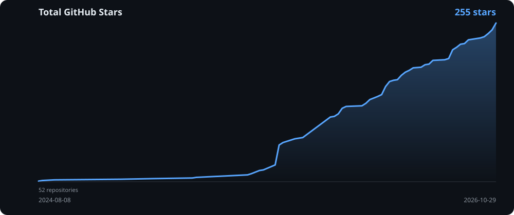

# 🦆🧑‍🦯 **QuackHack-McBLindy'z ⮞ home directory yay** 🦆🧑‍🦯

> [!CAUTION]
> **THIS IS NOT HOME-MANAGER!**
> **Ducks don't use home-manager.** 🦆

**Why?** I don't like it.

**🦆 duck say ⮞ quack - diz iz my directory**
**🦆 duck say ⮞ quack - my home my rulez**
**🦆 duck say ⮞ i create filez**

```nix
  file."ducks.md" = "🦆 duck say ⮞ like diz yay";
```

**🦆 duck say ⮞ i symlink pathz**

```nix
  link".config/myapp" = pkgs.somePackage;
```


## 🦆 ⭐ 🦆 ⭐ 🦆 ⭐

[](https://github.com/QuackHack-McBlindy/)
